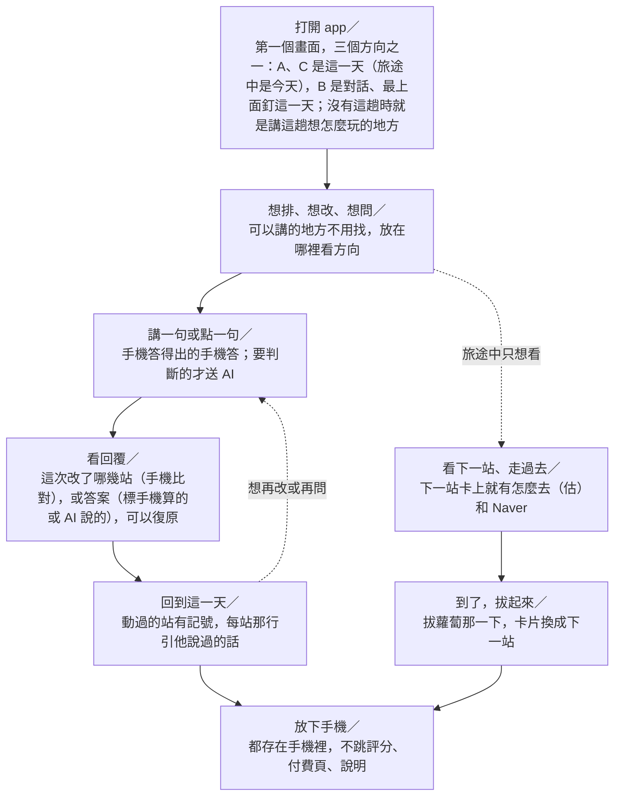
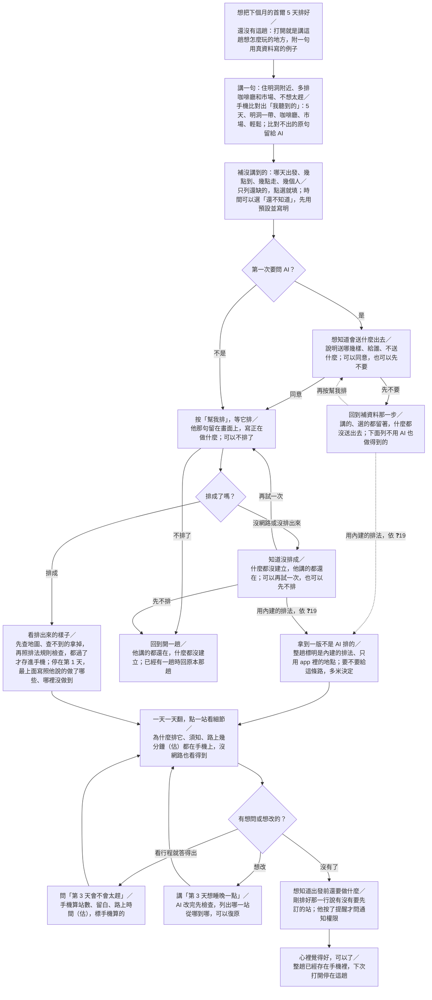
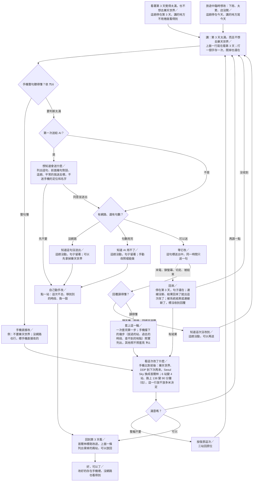
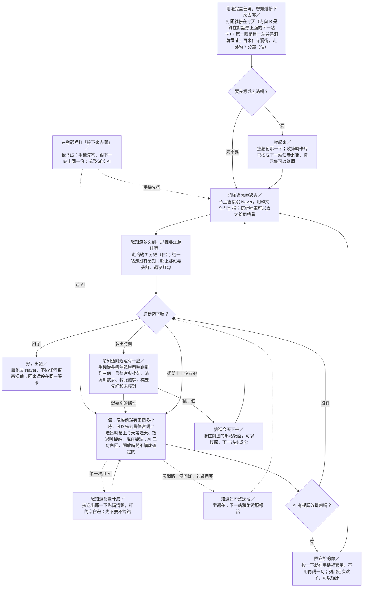
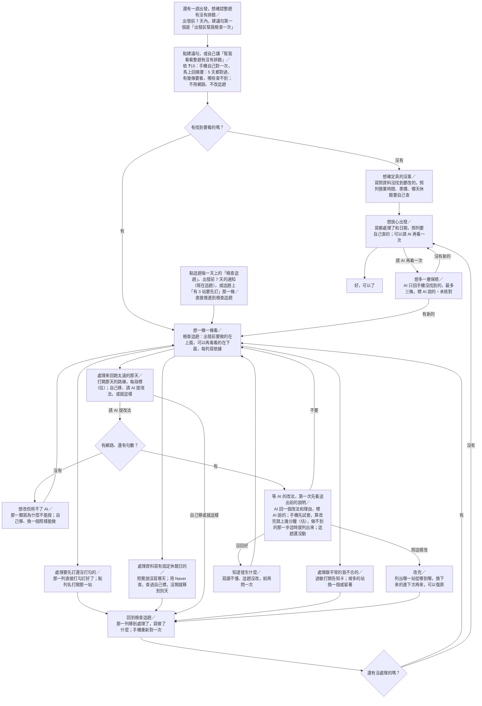
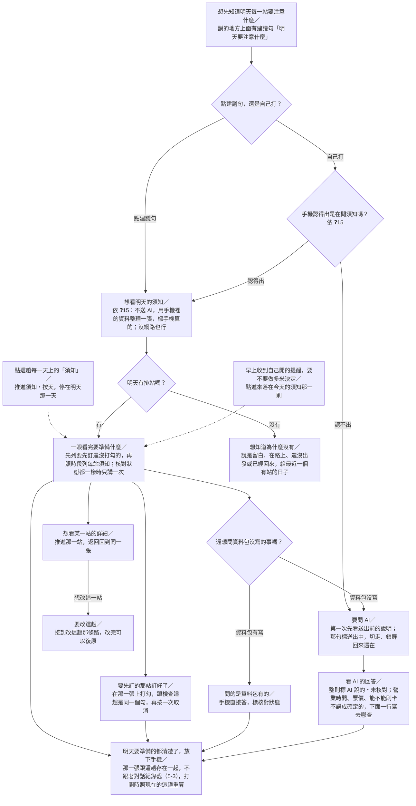

# 流程與資訊架構（暫定）

v1｜暫定｜2026-11-22｜接核心動作卡草稿 v2（閘門 1 未過）｜樹狀測試待測｜依審查意見修過一輪

## 先講結論

- 分頁三個：這趟（一次看一天）、對話（這趟的對話串）、旅行（每一趟、下次再來、去過的）。「平常的我」改成右上角入口；「行前」拆進這趟，變成檢查這趟、須知、花費三個入口，其中檢查這趟、須知在這趟每一天都有常駐入口，不收進「更多」。
- 跟 AI 講分兩層：對話是一個地方，佔一格分頁，切走再切回來還在；「講一句」是動作，在這趟每一天都不用捲就看得到（方向 A、C 放在這一天的畫面上，方向 B 打開就是對話）。一站、檢查這趟、附近還有什麼，另有跟那一頁有關的入口。
- 從清單點進去看一個用推進（一站、檢查這趟、須知）；做完就結束的小事用半頁（第一次問 AI 的說明、移到別的時段、更多）；拔蘿蔔那一下、給司機看用全螢幕。
- 下一站、怎麼去、須知、要先訂、這天幾站都在手機裡算，沒網路照樣看得到整趟；只有要 AI 判斷的句子要網路，送不出去時字留著、這趟不動。
- 打開 app 停在這一天還是停在對話，是核心畫面三個方向要比的事（第 8 段），多米決定。取捨先講白：要 AI 對話當第一個畫面的主角，三個方向裡只有 B 做得到；A、C 的主角還是這一天，講的入口排第二顯眼。

這份為什麼是暫定：

- 核心動作卡暫定版寫在 `.uiux/01-核心動作卡-暫定.md`（2026-11-22，閘門 1 未過）。這份是從那張卡推出來的，五欄的原文也摘在附錄一，多米可以對著看流程從哪裡推出來。`.uiux/閘門紀錄.md`（2026-11-22）記的是：核心動詞多米選了「講」；成功的感覺沿用舊句，等多米重新確認；不做清單等多米刪改；還沒有 3～5 個真人的情境觀察；閘門 1 未過；多米選「一路做暫定版」。
- 五條任務路徑來自多米說的五種用法，是設計者的預想（2-1），要拿觀察核對；第 4、5 題的讀法要多米確認（❓50）。
- 樹狀測試還沒做（第 7 段）。閘門 1 過了以後卡若有改，這份標「依舊卡，待重看」。

依據：多米 2026-11-22 的要求（原話記在核心動作卡草稿）、核心動作卡草稿 v2、五條任務路徑草稿、`HANDOFF.md` 第 5～10 節、`.vibe/產品定稿.md`、`.vibe/HANDOFF.md`（2026-11-16 的會話交接）、`docs/受眾未滿足的需求.md`、`docs/跟AI討論行程的情境清單.md`、`.uiux/審查紀錄.md`（11-14、11-16）、`.uiux/lessons.md`、`.uiux/05-設計代號/詞彙表-暫定.md`、`.uiux/閘門紀錄.md`，和 `ios/` 現在的程式（分支 swiftui，讀到 c390b4e）。

多米看過畫面後的回饋，這份當約束：

- 一頁只做一件事、一眼看完；「這趟」一次只看一天；主畫面不放總覽圖、不放統計數字；次要動作收進「更多」（`.uiux/lessons.md:5`）。
- 蘿蔔比喻：2026-11-16 多米說蘿蔔圖示和蘿蔔籃「莫名其妙不知道幹嘛用的」，拔蘿蔔「是個爽點，應該好好設計」；「蘿蔔籃」分頁當天改名「旅行」，出發前的列表也拿掉蘿蔔圖示（`.vibe/HANDOFF.md:14`、`:20`、`:41`）。`.uiux/lessons.md:5`（11-15）和詞彙表寫的「三處：每站旁那顆、拔起來、蘿蔔籃」比這次回饋早。這份把「拔起來」那一下當蘿蔔出現的地方；下一站卡上那顆蘿蔔，2026-11-25 多米定拿掉（❓48），清單每一站用的是類別圖示。沒有作用的裝飾角色不要；「大站／小站」不上畫面。
- 拔蘿蔔是爽點，要好好設計。
- 開一趟要快，一句一句問太長。
- 介面色維持蘿蔔橘；這一輪是灰階，不談顏色。
- 鐵則（`HANDOFF.md:96`）：不掉資料（行程存在手機裡，沒網路也看得到全部；會改行程的都能復原）、不騙人、不做成癮機制、排序沒有私心。

## 1. 核心迴圈

### 1-1 倒著寫

成功的感覺（舊句，等多米重新確認或改寫）：「有按照我的需求排得很客製化，很放心」（`HANDOFF.md:24`）

| 倒著數 | 使用者在做什麼／app 怎麼回應 | 它怎麼幫最後那一刻 |
|---|---|---|
| 最後一格 | 放下手機。改好的、問到的都已經存在手機裡，這時不跳評分、付費頁、說明（2-9：可以放下手機的結尾） | 「很放心」那一刻不被打斷；下次打開、沒網路都還在 |
| 前一格 | 回到這一天看：每站那行引他說過的話（「你說想多排市場」）；剛動過的站有記號；估的帶（估），沒核對的照實寫 | 「照我的需求」在畫面上找得到依據；真的、估的、沒核對的分得出來（鐵則：不騙人） |
| 再前一格 | 看回覆：手機自己比對寫出「這次改了」哪一站從哪到哪；或手機算的答案；或 AI 說的話。兩種來源都標出來，旁邊一顆復原 | 看得到它照他說的做了什麼，做錯了收得回來（2-8：能復原就不用確認） |
| 再前一格 | 講一句或點一句：「第 3 天太滿」「接下來去哪」「明天要注意什麼」。手機答得出的手機答，要判斷的才送 AI（手機先答到哪裡，依 ❓15） | 「我的需求」從這一句來；手機答得出的不用等網路 |
| 再前一格 | 講的地方不用找：第一個畫面上就有可以講的地方，三個方向放的位置不同（第 8 段） | 在路口那幾秒也講得出口。看得到的入口，人只要認出來，不用記它在哪（公理 1：認出比想起容易）；它是第一眼的主角還是第二顯眼，看方向（2-6）。要捲才看得到會不會影響找得到，是閘門 2 要測的假設 |
| 第一格 | 打開 app → 第一個畫面，三個方向之一：A、C 是這一天（旅途中是今天），B 是對話、最上面釘這一天；還沒有這趟時，這裡就是講這趟想怎麼玩的地方 | 第一眼看到這趟，或看到可以講的地方；沒網路時這趟一樣看得到 |

### 1-2 順著畫一次



### 1-3 旅途中的小圈：看下一站、拔起來

旅途中還有一個圈不經過講：打開 → 看下一站 → 跳 Naver 走過去 → 到了拔起來 → 卡片換成下一站 → 放下手機。核心動作卡把這件事標成待觀察（情境 8：人在路口那幾秒可能只想看、不想講，屬想像）。這份把它畫成主迴圈旁邊的小圈：下一站和怎麼去在講之前就擺在卡上，不用網路、不問 AI。觀察如果證實首爾那幾天多半是這樣，就碰到 3-1 失效邊界 1 的平行核心，核心動作卡要多一欄「第一個畫面的主角是誰」，只能填一個；第 8 段方向 B 跟 A、C 差的就是這一欄。

拔蘿蔔那一下是這個圈的結尾，多米說它是爽點。流程上它只在下一站卡出現（一站裡補拔的安靜做完，現在就是這樣）；它前後不插 AI 的話、不跳說明、不問權限。收掉時卡片已經換成下一站，提示條帶復原。

### 1-4 現在 app 裡不在這條鏈上的格子

刪不刪、降不降，多米決定。

| 現在的格子 | 在哪 | 建議 | 理由 |
|---|---|---|---|
| 第一趟排好後的三步操作說明 | `TripScreen.swift:7` | 建議刪（❓38） | 改成讓每站那行和講的地方自己帶出能做什麼，不用說明修補介面（總管約束 8）。第二步的例子「第二天輕鬆一點」手機聽不懂（本機指令只認阿拉伯數字）；說的「提示上的復原」在 AI 改完時不會出現（`ChatSheet.swift:288` 回 nil）。新的人看不看得懂，要閘門 2 測（審查 11-16 #4） |
| 「我」裡的「再看一次操作說明」 | `MeScreen.swift:149` | 跟著上一列 | 說明刪了它就沒有用 |
| 第一次排的「多問四題」 | `StartTrip.swift:154` | 建議刪 | 改由他那一句和「我聽到的」決定；四題的答案現在按「幫我排」時寫進「我」，沒說一聲 |
| 開一趟的整頁表單 | `TripForm.swift` | 降級成「還缺的幾項」，要不要換掉多米 11-16 定的表單見 ❓49 | 第一格換成講這趟想怎麼玩；表單只留那句話沒講到、又非填不可的（出發日、幾點到、幾點走、幾個人） |
| 下一站卡正下方的「換算、記一筆花費」 | `TripScreen.swift:128` | 降級成入口（更多、花費） | 跟下一站搶第一眼；它不幫「接下來去哪」那一刻 |
| 標題下的「改日期、住哪、這趟的調整」 | `TripScreen.swift:177` | 降級成入口 | 「更多」裡已經有「行程設定」去同一張卡；次要動作收進更多（`.uiux/lessons.md:5`） |
| 當天清單下面那行「N 站・路上大約 M 分鐘（估）。點一站看韓文名稱、花費、怎麼去，也可以移走或換掉。」 | `TripScreenParts.swift:177` | 後半句建議刪；前半句留不留見 ❓32 | 後半句是用文字教怎麼用（總管約束 8）；前半句是統計數字，多米說主畫面不放 |
| 對話第一句旁的蘿蔔人頭像 | `ChatSheet.swift:116` | 建議刪（❓27） | 多米說過沒作用的裝飾角色不要；「想一下…」已經表示在等；11-16 起蘿蔔只留在拔起來那一下 |
| 「這趟走完了」那張卡上鞠躬的蘿蔔人 | `TripScreen.swift:196` | 建議刪 | 沒有作用的裝飾角色；那張卡要做的是補拔、看去過的地方（審查 11-16 #13） |
| 拔蘿蔔那一下底下歡呼的蘿蔔人 | `PullMoment.swift:215` | **2026-11-25 多米定拿掉（❓48），已拿掉** | 蘿蔔只留拔起來那一下 |
| 下一站卡上的那顆蘿蔔 | `TripScreenParts.swift:270` | **2026-11-25 多米定拿掉（❓48），已拿掉** | 11-16 多米說蘿蔔圖示莫名其妙；清單每一站用的已經是類別圖示 |
| 「行前」分頁 | `RadishApp.swift:60` | 降級成這趟裡的入口 | 見 5-4 |
| 「我」分頁 | `RadishApp.swift:63` | 降級成右上角入口 | 見 5-4 |

## 2. 任務路徑

五條，一條一句，之後直接當樹狀測試的題目（第 6 段）。來源是多米說的五種用法，一種一條。第 4、5 題的讀法要多米確認（❓50）：「幫忙看行程」這裡寫成還有一週出發時檢查整趟；「匯報每個行程要注意的地方」這裡寫成他開口問了才說，另一種讀法是 app 主動告訴他。

| # | 任務句 | 多米說的用法 |
|---|---|---|
| 1 | 你下個月要去首爾玩 5 天，住明洞附近，想多排咖啡廳和市場，不想太趕。請用這個 app 把行程排出來。 | 叫 AI 規劃行程 |
| 2 | 行程排好了，你覺得第 3 天太滿，而且不想去樂天世界。請把它改掉，改完說得出動了哪幾站。 | 調節行程 |
| 3 | 你人在首爾，剛逛完益善洞，想知道接下來去哪、怎麼過去。 | 問接下來去哪 |
| 4 | 還有一週出發，你想確認整趟有沒有排錯：會不會遇到休館、有沒有要先訂卻還沒訂的。 | 幫忙看行程 |
| 5 | 明天要去的地方，你想先知道每一站要注意什麼，例如要帶現金、要排隊、要先買票。 | 匯報每個行程要注意的地方 |

每一格寫「使用者想做什麼／app 怎麼回應」，不寫按鈕長相。

### 2-1 排這趟

要網路的格子：等 AI 排、地圖查證、用講的改。比對「我聽到的」、補還缺的、一天一天翻、「第 3 天會不會太趕」都在手機上。第二趟起要先買一趟（`HANDOFF.md:155`），那一叉在哪一步出現是閘門 4，這張圖不畫，購買的岔路寫在 3-1。



### 2-2 改這趟

要網路的格子：送給 AI 的那一句。手機整句聽得懂的（不要樂天世界、第 3 天上午下午對調）、「這次改了」的比對、復原、放回都在手機上。



### 2-3 接下來去哪

這條一般整條在手機上：下一站、怎麼去（估）、須知、拔起來、附近還有什麼。下一站卡上的答案是畫面本身，不經過問答；在對話裡打字問「接下來去哪」那一叉依 ❓15。卡上沒有的問題（可以先去昌德宮嗎）才要網路；跳到 Naver 之後，Naver 找路要網路。



### 2-4 出發前檢查

檢查、打勾、移動、看路線（估）、過敏告知卡都在手機上。請 AI 提改法、請 AI 再看一次、跳 Naver 查休館要網路。手機先對一次那一叉依 ❓15。



### 2-5 要注意什麼

整理今天、明天、下一站、整趟的須知都在手機上。資料包沒寫的追問（能不能刷卡、要穿什麼）才要網路。手機先整理那一叉依 ❓15。



### 2-6 路徑長度

只看會不會猶豫、會不會退回，不數點擊（3-2）。

高頻（每天或每趟好幾次）：

- 接下來去哪（在首爾每天好幾次）：答案要在打開那一下就在下一站卡上。現在找路藏在「地圖與韓文」後面，字面沒說找路，進去還要往下捲（審查 11-16 #11），人可能在這裡停下來找。剛逛完還沒拔時，卡上寫的是剛逛完那一站（`TripScreenParts.swift:232`），會讓人以為那是接下來要去的。
- 改這趟：講的地方現在在當天清單和地圖下面，站多要往下捲（`TripScreen.swift:142`、審查 11-16 #5），看不到的人可能以為不能講。改完回到這一天看不出動了哪裡（審查 11-16 #6），人會一站一站對。
- 要注意什麼（旅途中每晚或每早）：現在要一站一站點開才湊得齊明天的須知（`StopSheetParts.swift:129`）。

多米要快的一條：

- 排這趟：每趟只走一次，可是多米說開一趟要快，11-16 親自把一句一句問改成一頁表單。看的是會不會停住、會不會退回；第一次打開到看到排好的行程用碼表量（審查紀錄 11-16 待驗清單）。這份的提案是先講一句、再補還缺的、第一次再看一張說明、再等 AI，步驟比現在的表單多；換不換掉他定的表單見 ❓49。「還缺的」只列還缺的；按「幫我排」之後畫面說正在做什麼。

低頻（每趟一兩次）：

- 出發前檢查：要看的是處理完一條回到清單時，下一條在不在眼前。

## 3. 四條岔路表

只列，畫面怎麼設計留給 3-6。

### 3-1 五條路徑共用

| 岔路 | 情況 | 要守住的 |
|---|---|---|
| 第一次 | 第一次要送給 AI（還沒同意過） | 按送出那一下才出說明；這次送什麼照實列（前面幾句對話也算），過敏點名，旅途中多送的也列；不送手機的定位、名字、聯絡方式；「先不要」是他的選擇，打的字留著，手機做得到的照樣能用；同意過不再問，平常的我裡收得回 |
| 第一次 | 第一次打開對話，還是空的 | 一句開場加照這趟走到哪換的建議句；不另做教學頁（總管約束 8） |
| 沒內容 | 還沒有這趟 | 在對話或這趟講什麼，都帶到開一趟，打的字跟過去 |
| 沒內容 | 說的站不在這趟、天數不存在、那個時段沒排站 | 手機先查，答得出就直接答，不送 AI（例：「這趟只有 5 天」「樂天世界不在這趟，在下次再來」） |
| 沒內容 | 緊急：朋友不舒服、受傷、東西掉了、被偷 | 手機先認出來，不送 AI；直接推進到須知裡「出事的時候打這些電話」（112、119、1330、觀光警察，人工整理、附核對日期，`PrepThere.swift:27`）；認錯時那一則下面給「不是這個，要問 AI」（`docs/跟AI討論行程的情境清單.md` 第二節第 12 類、第七節） |
| 沒內容 | 問到 app 不做的事：幫我訂房、比價、頭痛吃什麼藥、這樣一定能入境嗎、幫我寫那一句 | 手機回一句固定的話，給去處，不交給 AI 自由回（產品定稿禁用清單有「保證免簽、保證入境」）：訂房比價說這個 app 不訂東西；醫療不給建議，給出事時打的電話；入境不保證，給檢查這趟裡附核對日期的那幾條；那一句是他自己的話，不代寫（情境清單第五節） |
| 失敗 | 沒網路 | 送出前就看得出；要 AI 的句子不送、留著，說這趟沒動；手機答得出的照答；連上之後不自動送 |
| 失敗 | AI 沒回、等太久、回的讀不懂、回得不完整（回到一半斷掉、少一段） | 這趟不動，照實說是哪一種；句子留著可以再送；不退回手機指令照猜改這趟（現在會，`ChatSheet.swift:243`、`:258`）；這句算不算句數照 ❓28 寫在同一句裡；錯誤代碼放小字給客服看 |
| 失敗 | 手機擋下其中幾步：動到拔起來的站、過去的時段、地圖查不到、對不到站 | 擋下哪幾步、為什麼，照實列在那一則；直接套的命令（2-2）和等他按的提議（2-4）各一條規則，整批不套還是跳過做不到的，見 ❓51 |
| 失敗 | AI 句數用完 | 手機答得出的照答；手動改（移、換一個、這次不去、拔起來、復原）一步就到；打的字留著；買更多放哪是閘門 4，這裡不畫 |
| 失敗 | 購買：第二趟要先買、句數要加買時，按了取消、買失敗、還在等待中（例如等家長同意） | 付費頁不畫（閘門 4）。取消照他選的做，打的字和講的都留著，不寫錯誤；失敗說清楚這次沒有扣款、可以再試；等待中照實寫等待中，這趟不動；恢復購買一直找得到（2-8、2-13） |
| 失敗 | AI 提的地點地圖上查不到 | 不放進這趟，說一聲（HANDOFF 5-8） |
| 失敗 | 回報一則 AI 的回答（HANDOFF 第 9 節：每則 AI 回答都可以回報） | 每則 AI 回答都有「回報這則」，按了在那一則下面展開，寫清楚會送出哪一則；沒網路先存在手機裡，連上再送，送出後說一聲；回報不動這趟，那一則照留、標已回報 |
| 失敗 | 看錯天：對話上面那行寫的天，跟他想講的不是同一天 | 規則只有一條（5-3）；點那一行就能換天，換了只影響下一句；句子裡講了第幾天，以句子為準 |
| 失敗 | 定位權限 | 五條路都用不到，不問；只有地圖的「我在哪」、或之後的「用我現在的位置」（❓34）才問 |
| 失敗 | 通知權限被拒 | 只少了提醒；這趟上的提醒條照樣在；說一次，不追問（系統的授權通常只問得到一次，2-12） |
| 失敗 | 存不進手機（空間滿） | 說這一步沒存成；畫面上的先留著；講清楚重開會不會不見 |
| 不算失敗 | 他自己按先不要、不排了、不等了、就這樣、關掉、購買時按取消 | 照他選的做；不寫錯誤、不震錯誤（2-8、3-6） |
| 被打斷 | 打到一半：來電、鎖螢幕、切 app、往下滑關掉、被系統結束。所有打字的地方都算：對話的草稿（`ChatSheet.swift:68`）、開一趟（`StartTrip.swift:81`）、自己加一站的名稱（`AddSheet.swift:8`）、行程設定（`TripSettingsSheet.swift:17`）、一站裡的那一句（`VisitNote.swift:47`、`:54`，按完成或離開畫面才存）、平常的我裡自己打的那一格（`MeEditors.swift:520`） | 打的字隨時存，跟這趟存在一起，回來原樣在；現在這幾處都是 `@State` 或離開才存，被系統結束就沒了。那一句是他自己的話，最不該掉。沒丟東西就不用問「要放棄嗎」（2-8） |
| 被打斷 | AI 在想的時候離開或被結束 | 同一時間只送一句；那一句一直看得到狀態。切走、鎖螢幕：連線沒斷、結果回來了就顯示，這一天標剛改過；連線斷了當作沒收到（iOS 背景行為要真機驗）。被系統結束：當作沒收到，寫「這句沒有收到回覆，這趟沒有動」，可以再送；要回來還拿得到結果，得做成後端工作（❓52）。算不算句數見 ❓28 |
| 被打斷 | 等回覆時換了一趟：在旅行切到另一趟（對話變成分頁之後做得到） | 每一句記住是哪一趟問的；回覆回來時不是現在這趟就不套，結果留在那一趟的對話裡，切回去看得到；現在這趟說一聲「〔那一趟〕的那句有回覆了，沒有套到這趟」。現在的程式會套到當下這趟、記進當下這趟的對話（`ChatSheet.swift:256` 用 `d.trip`；對話跟著那一趟收進其他排好的，`TripActions.swift:84`、`:100`） |
| 被打斷 | 改到一半 | 一輪動作一次套完（現在就是）；復原紀錄存進手機（現在只在記憶體，`AppStore.swift:38`；❓30） |
| 被打斷 | 回來停在哪 | 停在剛剛的分頁、那一天、推進到的那一頁（現在分頁和天數都是 `@State`，被結束回這趟的第 1 天或今天；❓39） |

### 3-2 各路徑另外要列的

排這趟

| 岔路 | 情況 |
|---|---|
| 第一次 | 平常的我還是空的：不另問四題；那句話沒講到的標「你沒說，先照一般的排法」，預設不准說成他的習慣（審查 11-14 #4）。第一次看到排好的：每站那行引他說的話；最上面一行由手機對照行程寫出照做了哪些、哪裡沒做到 |
| 沒內容 | 那句什麼都沒比對出來（只打「幫我排」）：不擋，全部用預設並標出來。講到這一版排不了的（順便去釜山一天、住仁川機場附近）：說這一版只排首爾和當天來回的近郊（水原華城、南怡島、愛寶樂園），住哪一帶只有明洞、弘大、江南、東大門。資料不夠（咖啡廳只有益善洞韓屋巷、延南洞咖啡街、聖水洞咖啡廳三處）：照實說。某一段是空的：在路上（幾點到）、故意留白（你說不想太趕）、這段沒排到（排不進去）三種分開寫。問的站不在這趟（「通仁市場排在哪天？」）：手機答「這趟沒排通仁市場」 |
| 失敗 | 按「幫我排」時沒網路：什麼都不建立，他講的都還在；要不要給內建排法那一版見 ❓19。AI 排的違反排法規則：收到整趟先用手機照 HANDOFF 第 5 節第 1 到 5 條和平常的我的硬規則全部查一次（一天超過 2 個主要景點、第一天和最後半天排了主要景點、同一個半天不在同一帶或相鄰半天跳太遠、沒有留白（排滿除外）、晚餐沒照吃的四種比例、排了絕對不吃的），修不了的寫在最上面那一行。排好的存不進手機：那一版先留在畫面上，不能讓他以為存好了 |
| 被打斷 | AI 在排的時候離開（來電、鎖螢幕、切去 LINE）：連線沒斷、排好了，回來就停在第 1 天；連線斷了或 app 被系統結束，就當作沒排成，回到他講的那句，什麼都沒建立，可以再排。要讓人放心切走、回來去拿結果，得把排整趟做成後端的一件工作，這會改到後端範圍（HANDOFF 7-1 的後端只轉 AI、轉地點查詢、檢查額度），見 ❓52；決定之前，畫面不寫「可以先離開」。已經有一趟時再排一趟：原本那趟在新的排好之前不動（❓13） |

改這趟

| 岔路 | 情況 |
|---|---|
| 第一次 | 第一次被 AI 改完：「這次改了」上的「復原這次」每一輪都在同一個位置。說明裡的例子要是手機真的聽得懂的 |
| 沒內容 | 說的時段沒排站（第 1 天上午在路上）、今天的站都拔完了又說「今天太累」、說的站已經在下次再來、天數不存在（5 天說第 7 天）：手機先擋，直接回一句，不送 AI。現在天數不存在會寫成「你在路上」（`Chat.swift` 的 `applyOps`） |
| 失敗 | 手機聽錯（句子裡有站名就算、一句只做一件事、「不想去」對不到、只認阿拉伯數字）：手機只接整句聽懂的；聽錯了，「這次改了」讓他馬上看到，按復原就回去。AI 的動作動到拔起來的站或過去的時段：手機擋下並說原因（c390b4e 已經做了）；其他步照套還是整批不套見 ❓51。拿掉在檢查這趟勾過「訂好了」的站：提醒退不退票要看買票的地方，不替退票下結論（❓36） |
| 被打斷 | AI 在想的時候他自己改了同一天：回來的動作不直接套，讓他選（❓37） |

接下來去哪

| 岔路 | 情況 |
|---|---|
| 第一次 | 第一次在旅途中打開：不放操作說明；第 1 天第一段寫從住的地方出發。第一次用附近還有什麼：不問權限，第一行寫起點；今天還沒拔任何一站時，先問「你現在在哪一站附近？」。第一次跳 Naver：沒裝就開網頁版（真機沒驗） |
| 沒內容 | 照日期還沒出發（提早到、日期填錯）：說還有幾天出發，給改日期（會動到整趟，可以復原）。今天沒有排站、今天排的都拔完了：兩種字分開，都接附近還有什麼和明天第一站。下一站還沒指定哪一間（明洞的名店韓定食（挑一間））：寫還沒指定，路寫成到明洞一帶，不把代表點講成店的位置。下一站是自己加的（沒座標）：寫距離不明，給用 Naver 搜。問的東西不在行程裡（藥局、便利商店）：不給沒查證的店名，給韓文搜尋字跳 Naver。附近沒有這趟還沒排的：照實說，不湊數 |
| 失敗 | 這條一般不用 AI；跳 Naver 本身不用網路，Naver 找路要網路；看這天的地圖底圖要網路，沒網路可能只剩點（真機沒驗） |
| 被打斷 | 切到 Naver 找路再回來：停在同一張卡，到了就拔。在 Naver 導航很久被系統結束：回到今天的卡就夠，附近清單不還原。回來時已經過很久（坐到晚上、過了午夜）：下一站從最後拔的那站往後找，前面沒拔的收成一行（❓33）。拔蘿蔔播到一半來電：拔起來的狀態在開始時就存了，不會漏拔 |

出發前檢查

| 岔路 | 情況 |
|---|---|
| 第一次 | 第一次檢查：不加說明頁，摘要第一句講對了什麼、找到幾條、哪些查不到。第一次自己標「我查過了，那天有開」：寫「你自己查過・11/23」，跟資料包的核對分開 |
| 沒內容 | 對完沒找到任何一條：寫「照資料沒找到要改的」，照列查不到的幾樣，不寫「沒問題」。全部處理完：寫「都處理了・日期」，這趟上的提醒條消失。某天沒排站：不算問題。已經出發：只對今天以後；回來之後不給這句建議句。問的站不在這趟（「樂天世界要先訂嗎」，但沒排）：手機答不在這趟，附資料寫的 |
| 失敗 | AI 的改法有一步套不上（那個時段在路上）：手機試套時就列出來，他按之前看得到；整批不套還是略過那一步見 ❓51。AI 提到不在這趟的站：那一條略過並說一聲。跳 Naver 查休館打不開：說可能是沒有網路 |
| 被打斷 | 切去 Naver 查休館再回來：回到同一站的卡。被系統結束：回到檢查這趟和開著的那一站（❓39）；做不到時，對話那則摘要寫「還剩 3 條」，摘要照檢查這趟的狀態算，不靠對話紀錄。AI 的改法還沒按就被打斷：改法跟這趟存在一起（不放在會被截的對話紀錄裡，5-3），回來還能按；這趟後來改過就寫可能對不上 |

要注意什麼

| 岔路 | 情況 |
|---|---|
| 第一次 | 第一趟還沒填平常的我：過敏、要避開階梯的提醒不出現，不拿預設假裝知道 |
| 沒內容 | 明天沒有站（整天留白、回程那天在路上、還沒出發、已經回來）：說是哪一種，給最近一個有站的日子。某一站資料包沒有須知（仁寺洞街、明洞逛街、一隻雞街、東大門設計廣場 DDP）：寫「資料包沒有這一站的須知」，不讓 AI 自己補。挑一間的站：寫還沒指定是哪一間，下面是這一類店的須知。自己加的站：寫資料包沒有它的須知 |
| 失敗 | AI 的回答把營業時間、票價、能不能刷卡講成確定的：整則標 AI 說的・未核對，下面一行寫去哪查（Naver 地圖、1330 旅遊諮詢，二手核對・11/16）；跟資料包不一樣時兩個都留。回答裡的店名只當字，不變成站 |
| 被打斷 | 須知那一則存的是「哪一天的須知」，跟這趟存在一起，不跟著對話紀錄截（5-3）；打開時照現在的這趟重算：昨晚的「明天」今天早上顯示「今天」，改過的站照改過的列 |

## 4. 進入點表

進入點和第一個畫面分開看：第一個畫面是圖示打開的那一頁（第 8 段的方向決定），進入點是使用者從哪裡進來。

| 進入點 | 落在哪個畫面 | 怎麼回主線 | 現在／要不要做 |
|---|---|---|---|
| 主畫面圖示，已經有這趟 | 方向 A、C：這趟・上次看的那一天（旅途中是今天）；方向 B：對話 | 落點就是主線 | 已有；現在固定停在這趟，看哪一天不記（`TripScreen.swift:29`） |
| 主畫面圖示，還沒有這趟 | 開一趟（方向 B 在對話裡排，❓12） | 排好跳到這趟第 1 天 | 已有，現在是表單 |
| 本機通知：出發前 7 天，現在這趟有要先訂還沒打勾的 | 檢查這趟（推進在這趟上） | 返回 → 這趟那一天；分頁列在 | 通知已有（`Remind.swift`），他按了提醒才問權限；點了之後的落點還沒做，現在只是打開 app（`System.swift` 只處理 app 開著時要不要顯示；❓40） |
| 本機通知：出發前 7 天，其他排好的那一趟（`Remind.swift:38` 每一趟各一則，標題是那一趟的名字和出發日，`:51`） | 先問一句「這是〔首爾 5 天・12/16 出發〕的提醒，要切到那一趟嗎？」：切 → 那一趟的檢查這趟；不切 → 停在現在這趟，什麼都不動 | 切過去之後，原本那趟在旅行的其他排好的，點一下切回來（現在切換不走復原，`TripsScreen.swift:173`）；返回 → 這趟那一天 | 現在點了只打開 app，看到的是現在這趟，對不上通知寫的那一趟；落點見 ❓40 |
| 本機通知：出發前一天再看一次 | 檢查這趟 | 同上 | 候選（❓41），他按了才開 |
| 本機通知：早上，今天要注意的 | 對話裡今天的須知那一則 | 分頁列在；點站名推進一站 | 候選（❓41）；他自己開、自己選時間、預設關、被忽略幾天就停（2-12） |
| App 捷徑、Siri：「接下來去哪」 | 這趟・今天的下一站卡（手機算的，不用網路、不問 AI） | 落點就是主線 | 候選（❓42）。App 捷徑裝好就能從 Siri、Spotlight、捷徑 app 叫出來；iOS 26 起可以在 Siri 裡直接顯示一小塊結果、不打開 app。這個 app 最低支援 iOS 18（`HANDOFF.md:213`），先寫成打開到今天 |
| Spotlight：搜站名 | 那一站（推進在這趟上） | 返回 → 那一天 | 候選（❓45），現在沒做 |
| 別的 app 分享進來（在 IG 看到一間店） | 系統分享選單裡一張小卡：「跟 AI 說：幫我排進這趟」或「先放進順路可去」 | 跟 AI 說 → 打開 app 到對話，句子填好、不自動送；順路可去 → 留在原本的 app | 候選（❓43）；要排進這趟得先過地圖查證（HANDOFF 5-8）；沒有這趟時落到開一趟 |
| 小工具 | — | — | 不做：產品定稿第一版不做主畫面小工具（`.vibe/產品定稿.md:39`） |
| 即時動態、動態島（下一站） | 這趟・今天 | 落點就是主線 | 候選（❓44，許願 12）；產品定稿沒寫到 |
| 傳給旅伴看 | — | — | 沒有進入點：傳出去的是純文字，不做深層連結（`MoreSheet.swift:85`） |
| 去過的旅行做成的地圖網頁 | — | — | 沒有進入點：網頁不連回 app |
| 從 Naver 切回來 | 離開前那一張（下一站卡、一站） | — | 算被打斷，見第 3 段 |

查證（2026-11-22）：App 捷徑的叫出方式見 [Apple：Shortcuts for developers](https://developer.apple.com/shortcuts/)；iOS 26 的互動結果卡見 [WWDC25 第 275 場](https://developer.apple.com/videos/play/wwdc2025/275)。通知、背景被結束的行為照書（查證日期 2026-10，可能已變）。

## 5. 結構與畫面清單

### 5-1 用 2-5 的結構表定位置

| 2-5 結構表 | 用 | 這份放進去的 |
|---|---|---|
| 平行的主要區塊，常常在它們之間切換 | 分頁 | 這趟、對話、旅行（三個，HIG 建議 3～5 個，經驗值） |
| 區塊裡從清單點進去看一個 | 推進 | 一站、檢查這趟、須知、花費、平常的我（從右上角進去）；已經有一趟時，從旅行推進開一趟；去過的那一趟現在是彈出卡（❓11） |
| 做完就結束的小任務 | 半頁或全螢幕模態 | 半頁：第一次問 AI 的說明、改這一站（移到別的時段、換一個、不想去這一站）、附近還有什麼、更多、行程設定、自己加一站、這一天的路線、過敏告知卡、剛剛那一則（方向 A）、早上提醒（候選）。全螢幕：給司機看、拔蘿蔔那一下 |
| 很少用的 | 某區塊裡的入口或右上角 | 平常的我（右上角）；備份、送給 AI 的資料收在平常的我裡 |

模態只裝一件事、出口要清楚，不在模態裡再推好幾層（2-5）。現在的彈出卡同一時間只能開一張（`Sheets.swift`），檢查這趟、一站改成推進，就不會被下一張卡蓋掉。已經有一趟時的開一趟，上一版寫成全螢幕模態；裡面要講、要補、第一次還要升起說明、再等 AI，等於模態上疊模態又在裡面等很久，這版改成從旅行推進（❓13）。

### 5-2 跟 AI 講放在哪一層

組合，三層：

1. 一個地方：對話分頁，裝這趟的對話串。照 2-5，它有自己的內容、切走再切回來還在，算地方，可以佔一格分頁；核心動作卡慣例 ❓2 第二段寫過，這樣不算違反。分頁列在每個分頁上都看得到，所以每個畫面都有一條路到對話。
2. 一個動作：「講一句」放在它所屬的畫面上，就是這趟的每一天，出發前、旅途中同一個位置，不用捲就看得到（2-5：動作放在所屬畫面或工具列）。不用捲的理由：看得到的入口人只要認出來，不用記它在哪（公理 1）；在 A、C 它是第二顯眼，在 B 它就是第一個畫面的主角（2-6）。要捲才看得到會不會影響找得到，是閘門 2 要測的假設，這份沒有定論。它放在哪、怎麼操作，是第 8 段三個方向的差別。
3. 跟那一頁有關的入口：開一趟（沒有這趟時，講這趟想怎麼玩）、一站（問 AI 這一站，候選）、檢查這趟（請 AI 提一個改法、請 AI 再看一次）、附近還有什麼（想要別的條件）。

不放講的地方：旅行、平常的我、給司機看、拔蘿蔔那一下、第一次問 AI 的說明、過敏告知卡。這幾頁各有一件自己的事（2-2：每個畫面只為一件事服務），要講就用分頁列去對話。

這份沒有用的三種放法（多米要改用其中一種，❓4 都列了）：

- 每一頁都常駐一列輸入（核心卡慣例 ❓1）：每一頁多一個要看懂的東西，跟「一頁只做一件事」互相拉扯。
- 分頁列中間一顆「問 AI」，按了跳出卡片（慣例 ❓2 前半）：分頁列放地方、工具列放動作（2-5，HIG 明確規範），手的預期對不上（公理 2）。
- 對話只留在彈出卡（現在的做法，慣例 ❓5）：彈出卡是暫時離開主線的結構（2-5）；往下一滑，打到一半的字跟著不見；講完要關卡才看得到這趟。這一種放在對照樹裡測（第 6 段）。

審查紀錄 11-16 #5（「用講的改行程」放哪）這份回答一半：講的地方在這趟每一天都不用捲就看得到，對話另有分頁；確切的位置交給線框的三個方向。方向 A 就是 11-16 #5 列過的做法一（固定浮在分頁列上方），差在 A 多了一格對話分頁、回覆用半頁接住。

### 5-3 對話頁的結構

- 根畫面是這趟的對話串，最新的在最下面。排的時候講的那句是第一則，排和改在同一串。
- 最上面一行「在看：第 3 天・12/6（日）」，規則只有一條：跟著這趟分頁最後看的那一天；旅途中剛打開 app、還沒換過天，就是今天。點這一行可以換天，換了只影響下一句；句子裡講了第幾天，以句子為準。他說「這天」「今天」才對得到。
- 輸入框在最下面，上面一排建議句照這趟走到哪換（出發前、出發前 7 天內、旅途中、回來後）。
- 回話有幾種樣子（照 `docs/跟AI討論行程的情境清單.md` 第三節）：改好了（這次改了、復原這次）、提議（等他按了才套）、手機算的答案、AI 說的、選一個（意思不清楚時兩三個按鈕）、跳出去（Naver、官方頁）、緊急（手機回一張固定的卡，同須知裡「出事的時候打這些電話」，不送 AI）、app 不做的事（一句固定的話加去處）。每則 AI 回答都有「回報這則」，在那一則下面展開，不另開一張卡。
- 回覆裡點了會去哪：站名 → 推進一站（在對話分頁自己的堆疊裡，返回回對話）；「看第 3 天」→ 切到這趟分頁的第 3 天；「看這 7 條」→ 推進檢查這趟；「看整趟」→ 推進須知。
- 從對話升起的模態三種：第一次問 AI 的說明、附近還有什麼、早上提醒（候選，S22），都是半頁。
- 每一則的狀態存在手機裡：草稿、送出中、沒收到回覆、還沒套的提議。每一句記住是哪一趟問的。同一時間只送一句。
- 對話留多少：每一趟的對話全部留在手機裡，不截。現在只留最後 40 則（`ChatSheet.swift:12`、`:287`），舊的直接截掉，截到排的那一句或還沒套的提議，就是沒有聲音的掉資料。一趟的 AI 句數有上限（20 或 100 句），全部留也不大；之後真的要截，截之前先說一聲。還沒套的提議、須知那一則、檢查摘要、等回覆的那一句，跟這趟存在一起、放在對話紀錄以外，不跟著截；每站那行引他說的話存在那一站上，不靠對話紀錄。
- 沒有這趟時：對話帶到開一趟，打的字跟過去（方向 B 則直接在對話裡排，❓12）。

### 5-4 現在的四個分頁怎麼處理

| 現在的分頁 | 這份的提案 | 照 2-5 的理由 | 代價 |
|---|---|---|---|
| 這趟 | 留，當分頁 | 平行的主要區塊，每天切回來好幾次；照分頁慣例，切走再切回來停在原地、再點一次回最上層。分頁列是自己做的（`RadishApp.swift:90`），這些慣例要自己做出來；現在看哪一天是 `@State`（`TripScreen.swift:29`），要改成記住 | — |
| 行前 | 拆進這趟：出發前 → 檢查這趟；在當地、回程 → 須知；花費 → 花費。三個都用推進。檢查這趟、須知在這趟每一天都有常駐入口，不靠提醒條或建議句才出現；花費在更多；對話的回覆也連得到。出發前那一段的要辦的事、行李要帶的、不能帶進韓國的、「〔日期〕提醒我還沒訂的」和「不用提醒了」、來源清單，全部搬進檢查這趟（`PrepBefore.swift:65`–`:71`）；沒有這趟時，開一趟那頁有一個入口到須知 | 裡面每一樣都是這一趟的細節，從這趟點進去看一個，照結構表用推進；出發前、旅途中各用幾次，不是常常切換的平行區塊；要先訂的本來就是從這趟的提醒條跳過去（`TripScreen.swift:223`）。「幫忙看行程」「匯報要注意的」兩種用法靠的就是這兩頁，收進更多等於藏主要的東西（2-2：漸進揭露只藏次要） | 用慣「行前」這個字的人第一下可能找分頁；旅途中常用換算的話多一步；沒有這趟時，要辦的事、行李現在看得到（`PrepScreen.swift:199` 只有花費要先有這趟），拆了之後要排好一趟才看得到；第 4、5 題和對照樹看（❓7） |
| 旅行 | 留，當分頁 | 一個地方：每一趟、下次再來、去過的；回來後會想翻（`.vibe/產品定稿.md:45`，怎樣算成功） | 用的次數少；名字 11-16 已經從「蘿蔔籃」改成「旅行」（`.vibe/HANDOFF.md:20`），詞彙表還沒跟著改（9-4） |
| 我 | 降成右上角入口，叫「平常的我」 | 設一次、每趟沿用，很少用；照結構表放某個區塊裡的入口或右上角；之後用講的也改得到（「以後都不要排夜店」，現在只有一站的卡做得到） | 用慣四個分頁的人要重找；備份、送給 AI 的資料收在裡面，多藏一層；第 7 題看（❓10） |
| （新）對話 | 新的分頁 | 見 5-2 | 分頁列多一格；跟這趟上講的地方是同一串對話的兩個入口，要看得出是同一個 |

上架以後分頁順序不要再搬（2-5 第七條）；現在只有多米自己在 TestFlight 用，要改趁現在（❓6）。

### 5-5 沒網路、句數用完

- 這趟、一站、檢查這趟、須知、花費、旅行、平常的我：全部在手機裡，沒網路照樣看；會改這趟的手動動作（移、換一個、這次不去、拔起來、復原）照樣能做。
- 對話：串照樣看得到；手機答得出的照答；要 AI 的句子送出前就說沒網路，字留著，這趟不動。回報這則先存著，連上再送。
- 開一趟：「我聽到的」、還缺的幾項都在手機裡比對；排要網路，沒網路時給不給內建排法那一版見 ❓19。
- 進入點都落在手機裡的畫面（通知落在檢查這趟、捷徑落在今天），沒有一個一進來就要網路。
- 方向 B 打開先到對話：沒網路時，釘住的這一天和手機答得出的照樣能用，要 AI 的句子送不出去；整趟在這趟分頁。
- 方向 B 句數用完：打開還是對話。釘住的這一天、手機答得出的、手動改（點釘住的卡切到這趟，移、換、不去、拔起來、復原）照樣能用；輸入框上寫這趟的 AI 句數用完了，要 AI 的句子打了留著、不送。第一個畫面的主要動作變成按了沒用，這是 B 的代價之一（第 8 段）。要不要在那裡賣、怎麼賣，閘門 4。
- 方向 A、C 句數用完：講的那一列或那排說法照樣在，手機答得出的照答，要 AI 的寫為什麼不能送；這一天的站照樣點得開、改得動。

### 5-6 畫面清單

詳細的真實內容在每個畫面的「會出現的內容」（結構化輸出的 screens 欄）。畫面清單三個方向共用；只有某個方向才有的畫面、或某個方向要改的，寫在那一列（S05 只有 A 有；B 時 S04 是打開的第一個畫面、S02 併進對話）。

| # | 畫面 | 結構 | 唯一主角 | 從哪來 | 回哪去 | 要處理的狀態 |
|---|---|---|---|---|---|---|
| S01 | 這趟・某一天（方向 A、C 的核心畫面） | 分頁「這趟」最上層；換天在同一頁上方切換。方向 B 時打開先到對話，這一頁是看整天的地方 | 這一天的站；旅途中的今天是下一站卡 | 打開 app（A、C）；分頁列；排好停在第 1 天；對話的「看第 3 天」；推進頁返回、卡關掉；拔蘿蔔收掉；捷徑（候選） | 一站、檢查這趟、須知（推進，後兩個是常駐入口）；更多、路線、附近（半頁）；剛剛那一則（方向 A）；對話分頁；給司機看；Naver | 第一次（剛排好那一行）；出發前、旅途中、回來後；留白、在路上、這段沒排到分開寫；今天沒排站、都拔完了分開寫；內建排法排的；剛改過；沒網路；句數用完；講的地方：空、有草稿、送出中、沒收到回覆；這趟收起來之後變成開一趟；被結束回來停在那一天 |
| S02 | 開一趟 | 沒有這趟時就是這趟本身；已有一趟時從旅行推進；方向 B 併進對話 | 我聽到的（他那句比對出來的幾項） | 第一次打開；旅行「開新的一趟」；沒排成退回；不要這一版；沒有這趟時的對話；這趟收起來之後 | 第一次問 AI 的說明（半頁）；等 AI（同一頁）；排好 → S01 第 1 天；不排了 → 原本那趟；須知（還沒排也能先看） | 第一次（平常的我是空的，標你沒說）；第二趟起；打到一半；缺必填；等 AI；沒網路；沒排成（錯誤字留一句這次算不算句數）；購買取消、失敗、等待中；句數或趟數用完（閘門 4）；被打斷回來 |
| S03 | 第一次問 AI 的說明 | 半頁 | 這次要送出去的那幾樣、送去哪 | 第一次要送給 AI 的那一下（排、改、問、請 AI 看都一樣） | 同意並送出 → 原畫面；先不要 → 原畫面，字留著 | 只一次；收回同意後再出現；有填過敏；旅途中多送的；前面幾句對話；沒網路照樣看得了 |
| S04 | 對話（方向 B 的核心畫面） | 分頁「對話」；方向 B 時是打開的第一個畫面，最上面釘一張這一天的卡 | 最新的一來一回 | 分頁列；這趟講的地方；附近「想要別的條件」；分享進來、早上提醒（候選） | 看第 N 天 → S01；站名 → S06；看這 7 條 → S11；看整趟、緊急 → S13；附近還有什麼 → S10；早上提醒 → S22（候選） | 第一次（空）；沒有這趟；在看哪一天；草稿；送出中；手機答的；改好了（只有最後一步那一輪能復原）；這次沒有動；有幾步被擋下；提議等他按；緊急；app 不做的事；回報這則；沒網路；讀不懂、逾時；句數剩不多、用完；購買取消、失敗；被打斷回來；換了一趟；他剛剛自己改過 |
| S05 | 剛剛那一則（方向 A 才有） | 半頁，蓋在這一天下半 | 這一則回覆（這次改了或答案） | S01 講的地方送出 | 往下拉 → S01；看整段對話 → S04 | 送出中；改好了；沒動；沒網路；讀不懂；句數用完；回報這則；被打斷回來 |
| S06 | 一站 | 推進（現在是彈出卡，❓11） | 這一站是哪裡、為什麼排它（該拆或該併，見 5-7） | S01 清單、下一站卡；S11；S04；S10；Spotlight（候選） | 返回原處；S07；S09；Naver；問 AI 這一站（候選） | 資料包的站；AI 加的；挑一間；自己加的；去過了；那一句打到一半被結束；從 S11 來；沒有須知；剛被移走自己關掉；沒網路；被結束 |
| S07 | 改這一站：移到別的時段、換一個、不想去這一站 | 半頁，一次一件 | 那件事要選的：時段、三個候選、只這次還是以後都不排 | S06；S11「那天沒開，移到別天」 | 做完 → 原處，提示條帶復原；返回 → S06 | 在路上不能選；超過 2 個主要景點先講；換過三輪；沒有別的候選；選到一半被結束 |
| S08 | 拔蘿蔔那一下 | 全螢幕覆蓋，點一下提早收 | 被拔起來的那顆蘿蔔 | 下一站卡「去過了，拔起來」 | S01，卡片已換成下一站 | 減少動態；來電打斷（已存）；被結束；按錯（復原、按錯了） |
| S09 | 給司機看 | 全螢幕模態 | 放大的韓文名稱 | 下一站卡；S06 | 原處 | 沒有韓文名稱不出現入口；最大字級換行 |
| S10 | 附近還有什麼 | 半頁，可拉全高 | 照距離排的三個地方 | 下一站卡；今天沒排站或都拔完；S04 | 排進來 → S01；看那站 → S06；想要別的條件 → S04 | 第一次（寫起點）；起點不明；空；再看三個；被打斷不還原 |
| S11 | 檢查這趟 | 推進（在這趟或對話的堆疊裡） | 還沒處理的那幾條 | 這趟每一天上的常駐入口；這趟的要先訂提醒條；S04 的檢查摘要；出發前 7 天通知 | S06、S12、S15、S03；返回原處 | 第一次；沒找到任何一條；全部處理完；要辦的事、行李打勾；提醒還沒開、已開、權限被拒；AI 那一列在等；AI 沒回好；沒網路、句數用完；這趟在別處改過；被打斷回來；已經出發；沒有這趟進不來 |
| S12 | 這一天的路線 | 半頁可全高（現在的看這天的地圖）；AI 的改法在同一張換一面 | 這天每一段怎麼去、路上大約幾分鐘（估） | S01；S11 的繞路那一列 | 照這樣改、就這樣 → 原處；自己移 → S06 | 沒網路；句數用完；第一次送 AI；等 AI；讀不懂；改法有一步套不上；回報這則；被打斷 |
| S13 | 須知 | 推進；分段：在當地、按天（一次看一天）、回程 | 這一段的清單 | 這趟每一天上的常駐入口；S04「看整趟」、緊急；S11；S02（沒有這趟時） | 返回；站名 → S06 | 整段都沒核對只講一次；混著每行標；按天一次一天、過去的日子不預設打開；某站沒有須知；沒有這趟（從開一趟來）只有在當地、回程 |
| S14 | 花費 | 推進（從更多） | 每人大概花多少（估）；旅途中是換算（該拆或該併） | 更多；S04 | 返回 | 匯率沒填；全部粗估；記一筆存不進去 |
| S15 | 過敏告知卡 | 半頁（沿用） | 給店員看的那段韓文 | S11；吃的站的 S06；S13 | 原處 | 沒設過敏就沒有；韓文未核對 |
| S16 | 更多 | 半頁（沿用），從某一天打開 | 這一天和這趟的次要動作；這趟的順路清單（2026-11-25 多米定：每趟一份，每一列可以拿掉、可以復原） | S01 | 做完 → S01，提示條帶復原；這趟不排了 → 這趟變成開一趟，提示條帶復原 | 有可復原（第一列）、沒有；旅途中多今天排輕一點；只有一個時段不顯示對調 |
| S17 | 行程設定 | 半頁（沿用） | 這趟的條件：日期、住哪、名稱、封面 | S16 | S01 | 改日期不整趟重排；要重排時說會動到哪裡、可以復原；打到一半被結束 |
| S18 | 自己加一站 | 半頁（沿用） | 他要加的那個地方 | S16 | S01 | 沒座標；一定要去還是順路有空再去（放進這趟的順路清單，同一個名字不重複加）；打到一半被結束 |
| S19 | 旅行 | 分頁；分段：我的旅行、下次再來 | 這一段的清單 | 分頁列；S01 紀錄裡的「在下次再來」 | S01；S02（推進）；S20；排回這趟 → S01 那一天 | 空；沒有這趟不顯示排回這趟；放不回原時段 |
| S20 | 去過的那一趟 | 現在是彈出卡；照 2-5 是推進（❓11） | 那一趟去過的站 | S19；回來後的 S01 | 原處；做成地圖網頁 → 系統分享 | 空；照片多；網頁做失敗 |
| S21 | 平常的我 | 推進（從右上角） | 每趟沿用的習慣清單 | 右上角入口；S04 改習慣的提議（之後）；這趟上「平常的我改過了」那一條 | 返回原處 | 第一次（都是預設，標還沒設）；改了之後這趟要不要重排；送給 AI 的資料可以收回；全部清掉重來（沿用確認卡）；貼上備份還原（先另存一份）；自己打的那一格打到一半被結束 |
| S22 | 早上提醒（候選） | 半頁 | 幾點提醒（他選，預設關） | S04 須知那一則最下面 | 原處；開始提醒那一下才問權限 | 還沒問權限；被拒；已開；被忽略先停；這趟結束自動停 |
| S23 | 分享進來的那一張（候選） | 系統分享選單裡的小卡 | 分享進來的那個地方 | 別的 app 的分享選單 | 跟 AI 說 → S04（字填好不送）；順路可去 → 原本的 app | 沒有這趟；沒網路；地點查不到 |

### 5-7 該拆或該併

- 一站（S06）：三條路徑要的第一眼不一樣：要注意什麼要須知，接下來去哪要找路和韓文名，改這趟要移走、換一個。主角寫得出「這一站是哪裡、為什麼排它」，各路徑要的最前面卻不同。兩個做法（❓11）：一張照從哪來換順序（從檢查這趟進來時，最上面放這次查到的）；或拆成「一站」（看的：為什麼、須知、韓文名、找路、去過了）和「改這一站」（S07，半頁：移、換、不去）。
- 花費（S14）：出發前看估的花費，旅途中用換算、記一筆，同一頁兩個主角（❓14）。
- 這一天的路線（S12）：平常的主角是每一段怎麼去；請 AI 提改法之後同一張換成「這次會改」。兩個主角不同時出現，先不拆。
- 這趟・某一天（S01）：方向 B 時主角換成對話，這一頁退成分頁裡看整天的地方。
- 下一站卡（S01 旅途中）：一張卡上有站名、韓文、走路幾分鐘、Naver 找路、放大給司機看、須知、去過了拔起來、這站不去、附近還有什麼、晚上那站要先訂的提醒，方向 A 下面還有講的那一列和建議句。主要的是看下一站、找路（含放大給司機看）、拔起來；一行須知是內容；這站不去、附近還有什麼可以收；晚上那站要先訂的提醒放在卡上還是只留在這趟的提醒條，線框時比。

### 5-8 結構走查

照 3-2 自己走一遍查漏。認知走查會漏不少，取代不了第 6 段的樹狀測試；下面是查到的，不代表齊了。

- 這一版查到、已經補上的：購買的岔路（3-1）；2-1 不排了、先不要、先不排三條沒有去處（2-1 圖）；其他排好的那一趟的通知落點（第 4 段）；須知、花費走不到的「沒有這趟」狀態（須知從開一趟給入口，花費那一個刪掉）；「這趟不排了，收起來」之後落在開一趟（S16）；等回覆時換了一趟（3-1）；對話紀錄會被截（5-3）；回報這則、緊急、app 不做的事（3-1、S04）；所有打字的地方被結束會掉（3-1）；行前拆掉後沒有新家的那幾樣（S11）。
- 查到、還沒補的：付費那一叉的畫面（閘門 4）；被系統結束後回到哪要不要記（❓39 未定，現在不記）；方向 B 時 S02 併進對話的畫面細節沒寫；回報送出的內容要多米看過（❓23）；早上提醒、捷徑、分享進來、即時動態、Spotlight 等候選進入點要不要做（❓41～❓45）；沒有這趟時要辦的事、行李進不去（5-4 代價）；「排回這趟」之後要切到那一天（審查 11-16 #7）還沒做進程式。

## 6. 結構樹與樹狀測試包

### 6-1 主樹（這份的提案）

```text
這趟
  開一趟
  第 1 天
  第 2 天
  第 3 天
    這一天的站
      一站
        為什麼排這一站
        須知
        韓文名稱
        找路
        移到別的時段
        換一個
        不想去這一站
    跟 AI 講這一天
    看這天的地圖
    更多
      復原上一步
      上午和下午對調
      自己加一站
      花費
      行程設定
      傳給旅伴看
      這趟不排了，收起來
  今天・第 4 天
    下一站
      用 Naver 地圖找路
      放大給司機看
      去過了，拔起來
      這站不去
      附近還有什麼
    這一天的站
      一站
    跟 AI 講這一天
    看這天的地圖
    更多
  第 5 天
  檢查這趟
    出發前要做的
    可以再看看的
    要辦的事
    行李
    處理了
  須知
    在當地
    按天
    回程
對話
旅行
  我的旅行
    現在這趟
    其他排好的
    開新的一趟
    去過的旅行
      首爾 5 天
  下次再來
平常的我
  旅行回來想怎樣
  一天排多滿
  吃的偏好
  過敏和不吃的
  喜歡做什麼
  早上
  怎麼移動
  一天能走多少
  身體上要避開的
  住哪一帶
  從行程學到的
  預算
  資料與備份
  送給 AI 的資料
```

第 1、2、5 天點開跟第 3 天一樣，紙本上照抄；今天的「更多」點開也一樣。「平常的我」在畫面上是右上角一顆，樹上放第一層。檢查這趟、須知在畫面上是這趟每一天都看得到的兩個常駐入口（S01），樹上放在這趟底下、跟每一天並列，跟畫面一致。要比「收進更多」那一種，把它們搬到每一天的更多底下就是另一棵樹；人少時不建議三棵一起測（6-4）。

### 6-2 對照樹（現在的四個分頁，❓47）

```text
行前
  出發前
    這趟要先訂的
    檢查表
  在當地
  回程
  花費
這趟
  開一趟
  第 1 天
  第 2 天
  第 3 天
    這一天的站
      一站
        為什麼排這一站
        須知
        韓文名稱
        找路
        移到別的時段
        換一個
        不想去這一站
    看這天的地圖
    用講的改行程
    更多
  今天・第 4 天
    下一站
      地圖與韓文
      去過了，拔起來
      這站不去
    換算、記一筆花費
    這一天的站
      一站
    看這天的地圖
    用講的改行程
    更多
  第 5 天
旅行
  我的旅行
    現在這趟
    其他排好的
    開新的一趟
    去過的旅行
      首爾 5 天
  下次再來
我
  平常的我
  從行程學到的
  預算
  資料
```

### 6-3 題目

前五題用第 2 段的任務句，另加兩題現有功能。「這趟要先訂的有哪些」已經包在第 4 題裡，沒有另出。點了「對話」或「跟 AI 講這一天」（對照樹是「用講的改行程」）記在「交給 AI」那一欄，不算成功也不算失敗，做法見 6-4。

| # | 題目 | 算成功的終點（主樹） | 記成「交給 AI」的格子 | 要特別看的 |
|---|---|---|---|---|
| 1 | 你下個月要去首爾玩 5 天，住明洞附近，想多排咖啡廳和市場，不想太趕。請用這個 app 把行程排出來。 | 這趟 > 開一趟；旅行 > 我的旅行 > 開新的一趟 | 對話 | 第一下點這趟、對話，還是平常的我（以為要先設定）；對照樹看會不會先點行前（字面是出發前） |
| 2 | 行程排好了，你覺得第 3 天太滿，而且不想去樂天世界。請把它改掉，改完說得出動了哪幾站。 | 這趟 > 第 3 天 > 這一天的站 > 一站 > 不想去這一站（只做到一半，照記） | 對話；這趟 > 第 3 天 > 跟 AI 講這一天 | 交給 AI 是從第 3 天的跟 AI 講這一天，還是直接點對話，兩種分開記；先找講的地方還是先找那一站；後半「說得出動了哪幾站」是畫面內容，樹測不出，留給可點的版本 |
| 3 | 你人在首爾，剛逛完益善洞，想知道接下來去哪、怎麼過去。 | 這趟 > 今天・第 4 天 > 下一站（> 用 Naver 地圖找路） | 對話；這趟 > 今天・第 4 天 > 跟 AI 講這一天 | 第一下點這趟還是對話；進了這趟先找今天還是先找下一站 |
| 4 | 還有一週出發，你想確認整趟有沒有排錯：會不會遇到休館、有沒有要先訂卻還沒訂的。 | 這趟 > 檢查這趟 | 對話 | 有沒有找「行前」那樣的字（主樹沒有）；有沒有走進須知；有沒有先去更多找 |
| 5 | 明天要去的地方，你想先知道每一站要注意什麼，例如要帶現金、要排隊、要先買票。 | 這趟 > 須知 > 按天；這趟 > 某一天 > 這一天的站 > 一站 > 須知（一站一站看，算成功但另記） | 對話 | 是不是一站一站點，代表沒找到一次看完的地方 |
| 6 | 你想翻一下上次那趟首爾，當時走過哪些地方。 | 旅行 > 我的旅行 > 去過的旅行 > 首爾 5 天 | 對話 | 有沒有先點這趟或對話 |
| 7 | 你發現自己其實不太能吃辣，想讓之後每一趟都照這個排。 | 平常的我 > 過敏和不吃的；平常的我 > 吃的偏好 | 對話（講「以後都不要辣的」，之後才做得到） | 平常的我在樹上是第一層、畫面上是右上角一顆，樹測會高估找得到的程度（3-2 失效邊界 3） |

### 6-4 做法

- 把主樹印出來，每一層用紙蓋住，請他用手指點，點了才掀開下一層（經驗法則，一人開發可用）。
- 一次只給一題，念題目句，不解釋任何字。題目順序每人換：第 4、5 題的終點相近，前一題會教到後一題。
- 樹上把沒有這趟（開一趟）和旅途中（今天・第 4 天、下一站）畫在一起。第 1 題請他當作還沒排過；第 3 題當作人在首爾；其他題當作已經排好。
- 點了對話或跟 AI 講這一天（對照樹是用講的改行程）：在「交給 AI」那一欄記下是哪一格、第幾下點到，這一下不算成功也不算失敗；接著問一句「如果不打字，你會去哪裡找？」，讓他從第一層繼續點，之後的路照常記成功、直接度。他一開口就說「我會直接打字問」，也這樣處理。
- 第一下點哪一定記；往回走就在「有沒有退回」記一次。
- 不問好不好用、喜不喜歡（公理 10）。
- 找誰：觀察清單那批（最近要自己排首爾、整趟由他負責的人）。不找多米、不找很熟的朋友；Agent 不當測試者（元邊界 7）。人夠時每棵樹一輪 5 人、每人只看一棵；人只有 3～5 個時，每棵樹 3 人（三人一輪、輪數多一點，guardrails 學派分歧第五條），找不到 6 個人就把七題拆兩半，每人在主樹做一半、對照樹做另一半，下一個人兩半對調，兩棵樹都有第一下點哪的紀錄。
- 測完帶回原始紀錄；改了樹就換新的人再測。
- 這一步只測字和分組。講的地方看不看得到、第一個畫面的主角是誰、圖示、打字順不順，樹測不出來，留給三方向線框（3-3，閘門 2）和可點的版本（3-7）。

### 6-5 記錄表

| 受測者代號 | 看的樹（主樹／對照樹） | 題目 | 第一下點哪 | 交給 AI（哪一格、第幾下） | 不打字時接著點的路 | 完整路徑 | 有沒有退回 | 最後停在哪 | 成功 Y/N | 直接 Y/N | 他說了什麼 |
|---|---|---|---|---|---|---|---|---|---|---|---|
| P1 | | | | | | | | | | | |

### 6-6 卡片分類包（做不做見 ❓46）

照 3-2，東西約二十項以上、分組沒把握時，先做開放式卡片分類。這裡最沒把握的是行前、我那些東西該跟誰放一起。

卡片（一張一行，用畫面上會用的字，不寫分頁名）：這趟要先訂的站／出發前的檢查表（電子入境卡、網卡、旅遊險）／出發前再查一次休館、班次的站／會惹毛當地人的事／跟台灣不一樣的地方（電壓、公車不收現金）／每一站要注意的事／伴手禮／裝行李箱之前／每人大概要花多少／韓元換算／記一筆花了多少／這天的地圖／下次再來的站／去過的旅行／其他排好的一趟／開新的一趟／吃的偏好、過敏和不吃的／一天排多滿、早上、怎麼移動／住哪一帶／從行程學到的／複製備份、貼上備份還原／送給 AI 的資料／傳給旅伴看／跟 AI 講過的話

做法：便條紙一張一張給，請他分成幾堆、每堆自己取名字；不提示、不解釋。約 15 人（這個人數的研究來自網站內容分類，套到 app 只當方向）。

記錄表：受測者代號｜分了幾堆｜每堆他取的名字｜每堆裡的卡｜放不進去的卡｜他說了什麼

怎麼看：哪幾張常被放在一起；他們取的名字（進詞彙表）；行前那些卡有沒有被放進跟「這趟」同一堆。

## 7. 樹狀測試結果

待測。到 2026-11-22 為止，沒有任何沒看過的人看過這棵樹；Agent 沒有當測試者，這一段沒有任何結論。

| 題目 | 哪棵樹 | 第幾輪 | 測了幾人 | 成功率 | 直接度 | 交給 AI 幾人 | 成功但一路退回 | 很快很篤定地走錯 | 改了什麼 | 重測結果 |
|---|---|---|---|---|---|---|---|---|---|---|
| 1～7 | 主樹 | 第 1 輪 | 待測 | 待測 | 待測 | 待測 | 待測 | 待測 | — | — |
| 1～7 | 對照樹 | 第 1 輪 | 待測 | 待測 | 待測 | 待測 | 待測 | 待測 | — | — |

測完要把問題分三類：結構錯、標籤讓人誤會、畫面內容（樹測不出）。結構類才改樹，改了換新的人再測。成功但一路退回，記成標籤讓人沒把握；很快很篤定地走錯，記成標籤讓人誤會，兩種分開記。交給 AI 的人數另外看，不算進成功率。結構過關不代表圖示版過，也不代表有人會講（3-2 失效邊界 3、4）。

## 8. 核心畫面與三個方向（交給線框）

核心畫面：有這趟時，打開 app 的第一個畫面。它是哪一頁、主角是誰，看方向：

| 方向 | 核心畫面 | 第一個畫面的主角 | 講的入口 |
|---|---|---|---|
| A | 這趟・某一天（S01） | 這一天（旅途中是下一站卡） | 第二顯眼：畫面最下面一直有一列 |
| B | 對話（S04），最上面釘這一天 | 最新的一來一回 | 就是主角 |
| C | 這趟・某一天（S01） | 這一天（旅途中是下一站卡） | 第二顯眼：主角旁邊一排說法 |

為什麼是這一頁：

- 核心迴圈從這裡開始：打開、看這一天、講一句、看改了什麼、放下手機。
- 次數最多的兩條路（接下來去哪、改這趟）從這裡開始。
- 3-1 失效邊界 1 那一欄「第一個畫面的主角是誰」選的就是這一頁的主角，只能填一個。
- 多米要的「按鍵很明顯」、審查紀錄 11-16 #5 都落在這一頁。

取捨講白：多米要的「全部以跟 AI 溝通當核心」，三個方向裡只有 B 讓 AI 對話當第一個畫面的主角。A、C 的主角還是這一天，講的入口排第二顯眼；它們在結構上做到的，是把講的按鈕搬到不用捲的地方、多一格對話分頁。A 就是審查紀錄 11-16 #5 列過的做法一（固定浮在分頁列上方），多了對話分頁和半頁回覆。B 換了主角，代價是看整天要多走一步、沒網路或句數用完時第一個畫面的主要動作按了沒用。Agent 不選（❓5）。

三個方向差在第一個畫面的主角，和講放在哪、怎麼做。Agent 不評哪個好；三個都畫成灰階線框，給沒看過的人看（3-3，閘門 2）。

| 方向 | 主要動作在哪 | 怎麼操作 | 跟另外兩個差在哪 |
|---|---|---|---|
| A 這一天在上，下面一直有一列講的 | 這一天的畫面最下面、分頁列上方，一直有一列可以講（打字，或用鍵盤上的聽寫），上面一排照這一天換的建議句 | 點那一列，鍵盤升起；送出後回覆從下面升起成半頁（S05），上半還看得到這一天，動過的站當場標剛改過；往下拉收起回覆；「看整段對話」切到對話分頁。沒網路、句數用完：那一列照樣在，要 AI 的句子寫為什麼不能送，字留著 | 主角一直是這一天（旅途中是下一站卡），講排第二顯眼；講和看這一天在同一個畫面同時發生；畫面上一直多一列；鍵盤和回覆會蓋住下半個畫面；那一列跟提示條、下緣回主畫面的系統手勢在同一帶；就是審查 11-16 #5 的做法一 |
| B 打開就是對話，這一天釘在最上面 | 打開 app 先到對話分頁；最上面釘一張這一天的卡（旅途中是下一站卡，帶拔起來和 Naver），輸入框在對話最下面 | 打開就看到釘住的卡和最新一則；講完回覆接在對話裡；點釘住的卡切到這趟分頁看整天；沒網路、句數用完時釘住的卡和手機答得出的照樣能用，整趟在這趟分頁（5-5） | 主角換成最新的一來一回，這一天退成一張卡；看整天要多走一步；第一次打開是空的對話，要設計第一次的空（3-6）；對話越拉越長時，一眼看到的是釘住的卡和最後一則 |
| C 主角旁邊一排說法，點了就有答案 | 旅途中在下一站卡正下方；出發前放在這一天清單的最上面（天數切換下面），不放在清單後面，站多也不用捲。一排三、四句說法，照這趟走到哪換；畫面上沒有常駐的輸入框，只有一顆「自己講」 | 點一句：手機答得出的當場在說法下面展開答案；要改這趟的直接改、留復原；要 AI 判斷的送出後，「送出中」和回覆都在同一塊展開的地方，同一時間只送一句，全文同時記進對話分頁。沒網路、句數用完：說法照樣看得到，手機答得出的照答，要 AI 的那幾句按了寫為什麼不能送。點「自己講」切到對話分頁、鍵盤升起 | 主角一直是這一天，說法排第二顯眼；主要動作是點選，打字要多一步；位置在主角旁邊，不在畫面最下緣；說法照這趟走到哪換，換了之後找不找得到要測；這一頁沒有輸入框，鍵盤不會在這一頁升起 |

三個方向都能搭「用說的」：只靠鍵盤上的聽寫，或另做按住說話（❓26）。方向 A 的那一列：iOS 26 起系統有分頁列上方的附屬列，這個 app 最低支援 iOS 18、分頁列是自己做的，只能自己做（核心動作卡的查證，2026-11-22）。

## 9. 交給下一步

### 9-1 線框（domi-uiux-wireframe，3-3）

- 第 5 段畫面清單，第 8 段核心畫面三個方向。
- 要一起排的：講的地方、提示條（NoticeBar）、下緣系統手勢在同一帶；鍵盤升起時這一天還看得到多少（3-3 單手檢查表）。
- 下一站卡上「去過了，拔起來」和「這站不去」現在上下緊挨著（`TripScreenParts.swift:275`–`288`），單手走路時容易按錯；常用的跟會改這趟的要拉開（2-8）。卡上哪些是主要、哪些可以收，見 5-7。
- 檢查這趟、須知兩個常駐入口放哪（S01），不靠提醒條或建議句才出現。
- 復原的入口四個，退的是同一疊紀錄，字要寫出退的是哪一步：這次改了那一則的「復原這次」、這一天上面那條紀錄、提示條（8 秒）、更多第一列「復原上一步：〔剛剛做的事〕」（審查 11-16 #12）。對話裡只有還是最後一步的那一輪能按「復原這次」；之後又改過了（包括拔起來、手動移），舊的那幾則改成「之後又改過了」、不能按；要單獨退某一輪見 ❓30。現在對話裡的「復原上一步」退的是全 app 最後一步（`ChatSheet.swift:151`），中間拔過蘿蔔的話退的是拔蘿蔔。
- 每則 AI 回答的「回報這則」（S04、S05、S12），在那一則下面展開。
- 可點的版本出來後，用碼表量第一次打開到看到排好的行程、中間有沒有停住（審查紀錄 11-16 待驗清單，沒看過的人 3 位、每人一次）。

### 9-2 首次體驗（domi-uiux-onboard，3-6）

- 畫面清單的「要處理的狀態」、第 3 段四條岔路。
- 權限時刻：通知只在他按了提醒的那一下問；定位五條路都不問，只有地圖的「我在哪」；送給 AI 的說明在第一次按送出那一下，條文寫「前面幾句你跟 AI 說的話」和「不會送手機的定位」。說明的條文送審前對 Apple 最新版（HANDOFF 第 9 節；書的查證日期 2026-10，可能已變）。
- 第一次打開到看到排好的行程用碼表量（同 9-1），開一趟用講的還是表單，量了再定（❓49）。

### 9-3 上架與埋點（domi-uiux-launch，3-8）

- 第 4 段進入點表當埋點：從哪裡進來、第一下做了什麼、多久講第一句、講的句子有幾成是手機答的。

### 9-4 詞彙表（domi-uiux-tokens，2-14）

要定的新詞（樹狀測試裡受測者自己叫的名字，一起帶回來）：

| 要定的詞 | 指什麼 | 從哪條路來 |
|---|---|---|
| 對話 | 分頁名，這趟的對話串（❓8） | 多米說的「對話頁面」 |
| 我聽到的（暫名，要換成不帶人稱的，見下面） | 開一趟時，手機從他那句比對出來的幾項 | 排這趟 |
| 還缺的 | 開一趟還沒講到、又非填不可的 | 排這趟 |
| 剛改過 | 動過的站的記號 | 改這趟、審查 11-16 #6 |
| 手機算的，沒有問 AI | 手機自己答的。統一五條路徑寫的「app 算的」「手機自己對的」「用這趟的資料整理的」 | 五條都有 |
| 手機直接改的 | 手機整句聽懂、沒問 AI 就改的那一輪 | 改這趟 |
| AI 說的 | AI 寫的話，帶時間。統一出發前檢查寫的「AI 的看法」 | 檢查、須知 |
| AI 加的 | 排好之後用講的加進或換進來的站。整趟是 AI 排的還是內建的排法，在最上面一行標一次，不每站掛（審查 11-14 #10：全部都有等於沒有）；查證另外一個標籤（「地圖查得到・日期」或「未核對」）。兩條路徑草稿的定義不一樣，這份照分兩層寫 | 改這趟 |
| 內建的排法 | 沒問 AI、照 app 規則排的那一版 | 排這趟 |
| 這段沒排到 | 排不進去的時段，跟留白、在路上分開 | 排這趟 |
| 檢查這趟、出發前要做的、可以再看看的、要辦的事、行李、處理了 | 出發前檢查那一頁 | 出發前檢查 |
| 須知（整趟那一頁） | 在當地、按天、回程；跟每站的「須知」同一個字 | 要注意什麼 |
| 附近還有什麼 | 照距離列三個今天沒排的 | 接下來去哪 |
| 送出中、沒收到回覆、已回報、之後又改過了 | 一句話、一則回答的狀態 | 改這趟 |

要統一的說法（交給 tokens 一起定）：

1. app 講話的人稱：同一套介面字裡，「我」有時是使用者（平常的我），有時是 app（我聽到的、要更多跟我說、我查不到的、我不知道每家店用了哪些食材），S02 還寫成「平常的你」。手機算的和 AI 說的都用「我」講話，來源只能靠小字分。建議 app 講話不用「我」，「我」只留給「平常的我」；來源靠 9-6 的標籤分。
2. 「我聽到的」換成不帶人稱的標籤（候選：這句講到的）。
3. 「主要景點」用了詞彙表「不用」欄的「景點」；一站上的標籤「順路小地方」跟清單名「順路可去」只差兩個字，意思不同（一個有排時段、一個沒有），對照詞彙表重定。
4. 「AI 換的」「AI 加的」並存，留一個。
5. 講的入口有講一句、講的地方、跟 AI 講這一天、自己講、跟 AI 說、對話六種叫法，畫面上只留一個名字（跟 ❓8 一起定）。
6. 「這一天的路線」（S12）和「看這天的地圖」（樹、現在的按鈕）二選一。

要清的舊字：

- 拔蘿蔔那一句裡有「少一個坑，多一顆蘿蔔。」「收進籃子。」（`seoul.json` 的 pullLines）；詞彙表寫「坑」不用、「籃子」不當清單名。
- DDP 的為什麼寫「節奏選「趕」」，平常的我裡叫「排滿」（`PlanGenerate.swift:279`、`Labels.swift:52`）。
- 「行程設定」裡的「行程」跟詞彙表的「這趟」不一致。
- 我降成平常的我之後，「「我」裡的設定改過了」（`TripScreen.swift:228`）、花費頁「在「我」改」（`PrepCost.swift:57`）、說明卡「「我」分頁裡平常的習慣」（`ChatSheet.swift:99`）都要改說法。
- 詞彙表本身：「蘿蔔籃」那一列改成「旅行」（11-16 已改名）；「大站／小站」那一列改成畫面上現在用的說法（主要景點、順路的小地方，給 AI 的規則也這樣寫，`Chat.swift:585`），跟上面第 3 條一起重定；「蘿蔔的比喻只留三個地方」那一段照 11-16 的回饋改寫。

### 9-5 閘門 4 要用的：每條路徑一般用掉幾句

| 路徑 | 一般用掉幾句（五條路徑草稿的推算，沒實測） | 手機做得到、沒有問 AI 的 |
|---|---|---|
| 排這趟 | 排整趟 1 次（算不算句數還沒定），排完改 1～3 句 | 比對我聽到的、補還缺的、看行程、會不會太趕、固定說法、復原 |
| 改這趟 | 1～3 句 | 整句聽得懂的固定說法、這次改了的比對、復原、放回、還剩幾站 |
| 接下來去哪 | 0～1 句；每逛完一站都問 AI 的話，一趟 5 天約 12 句（手算 17 站，沒在 app 裡跑過） | 下一站、怎麼去（估）、須知、附近還有什麼、拔起來 |
| 出發前檢查 | 0～3 句（範例那趟 1～2 句） | 找問題、打勾、移動、看路線、告知卡 |
| 要注意什麼 | 0 句；追問一題 1 句；每次整理都問 AI 的話，5 天約 10 句 | 今天、明天、下一站、整趟的須知 |

事實：免費那一趟 AI 對話 20 句、再開一趟 100 句（`HANDOFF.md:154`）；`ios/` 裡還沒有計句數的程式。怎麼算見 ❓28、❓29。

### 9-6 畫面上要分得出來的來源（給線框和詞彙表）

1. 手機算的：站數、路上幾分鐘（估）、星期幾、須知整理、檢查。標「手機算的，沒有問 AI」，不包裝成 AI 的判斷。
2. 資料包的事實：「二手核對・11/14」「來源較舊・11/14」「未核對」；整段都一樣時只講一次（審查 11-14 #10）。
3. AI 說的：AI 寫的話，帶時間；講到時間、價錢、付款，下面一行寫去哪查。
4. AI 加的：排好之後用講的加進或換進來的站；查證另外標。沒過地圖查證的不排進這趟（HANDOFF 5-8）。
5. 他自己的：「你打勾說訂好了」「你自己查過・11/23」「你說這樣就好」，不寫成「已確認」「核對過」。
6. （估）：分鐘、公里、花費、幾點到，數字後面一律帶。
7. 整趟是誰排的：AI 排的寫「AI 照你說的排的」和日期，內建的排法寫「這一版是 app 內建的排法排的，沒有問 AI」，都在最上面一行講一次，兩種看起來不能一樣。
8. AI 不講成確定的：營業時間、休館日、票價、要不要預約、外國人訂不訂得到、天氣、人潮；不說「最佳」「完美」「不用再查」（HANDOFF 5-10、產品定稿禁用清單）。

### 9-7 lessons 回灌（建議寫一行）

2026-11-22｜flow｜五條任務路徑分頭寫，各自假設了不同的對話位置（彈出卡、分頁、打開就是對話），合併時要先拆掉這些假設｜下次規則：分頭寫路徑之前，先給一個暫定的結構假設（哪些是分頁），路徑裡只寫使用者想做什麼／app 怎麼回應，結構留到合併時定。

### 9-8 實作

見附錄二。轉 VibeRails 時附 `.uiux/05-設計代號/` 和詞彙表（總管約束 7）。進線框之前，先把核心動作卡寫成 `.uiux/01-核心動作卡-暫定.md`（附錄一是五欄）。

## 10. 要多米決定的事（❓）

編號沿用上一版；❓9 刪掉（旅行分頁的名字 11-16 已經定成「旅行」）；這版新加的從 ❓48 起。能推薦的每題寫了建議和理由；成功的感覺、不做清單、收費、方向選擇這幾類只列代價，不推薦。

線框之前要先答的：❓50（五句任務是不是你的意思）、❓1（成功的感覺）、❓4（分頁）、❓5（第一個畫面的主角，至少答三個方向都畫，還是現在就刪掉哪一個）、❓8（對話叫什麼）、❓15（手機先答還是全交給 AI）、❓49（開一趟用講的還是表單）。其他都標「可以等」。

前提（核心動作卡還沒定的）

- ❓50（線框之前）五條任務句是不是你說的意思，特別是第 4、5 題？「幫忙看行程」這份寫成還有一週出發時檢查整趟有沒有排錯。「匯報每個行程要注意的地方」有兩種讀法：一是你問了它才說（這份照這個寫，2-5）；二是 app 主動告訴你，例如前一晚或早上自己跳出來講明天要注意的，這會碰到許願 2「AI 主動推播」和 2-12（通知要是使用者要求的）。這是你的意思，Agent 不推薦。
- ❓1（線框之前）成功的感覺：沿用「有按照我的需求排得很客製化，很放心」，還是改寫？這一欄只能你寫；核心迴圈從它倒推，改了第 1 段要重看。
- ❓2（可以等）不做清單 13 條、許願 12 條逐條定。跟這份有關的：AI 主動推播（許願 2，碰到早上提醒和 ❓50 第二種讀法）、天氣自動改（許願 6）、沒網路也能講幾句（許願 10，這份的「手機答得出的手機答」是最小的版本）、即時動態（許願 12）。另外現在花費頁有「記一筆」「實際花的」，跟不做清單的「記帳」要對一下；行前的「行李要帶的」（這份搬進檢查這趟）跟不做清單的「逐項行李清單」也要對一下。
- ❓3（可以等，樹狀測試之前要答）觀察和測試找誰？建議 HANDOFF 第 11 節第二輪那 3～5 個近期要出國的人；樹狀測試、三方向線框都要沒看過的人，你自己和很熟的朋友不算。

結構

- ❓4（線框之前）分頁要不要改成「這趟／對話／旅行」三個，平常的我改右上角入口，行前拆進這趟？建議這樣：理由在 5-4，平行、常切換的才當分頁，行前和我都不是。另外四種放法和代價：四個分頁不動、只把講的地方拉到不用捲、對話留在彈出卡（往下一滑打到一半的字跟著不見，講完要關卡才看得到這趟）；行前和我都留、再加對話變五個（分頁列塞滿，三個不常切換的區塊佔著位置）；每一頁都常駐一列輸入（每一頁多一個要看懂的東西，跟一頁只做一件事拉扯）；分頁列中間一顆「問 AI」按了跳出卡片（分頁列放地方、工具列放動作，手的預期對不上）。要測了再定，兩棵樹都要有人測（6-4：人少時每棵三人）。
- ❓5（線框之前）第一個畫面的主角：這一天（方向 A、C），還是對話（方向 B）？取捨：要 AI 對話當第一個畫面的主角，只有 B 做得到；A、C 的主角是這一天，講的入口是第二顯眼，A 就是審查 11-16 #5 的做法一。B 的代價是看整天要多走一步、沒網路或句數用完時第一個畫面的主要動作按了沒用。這是方向選擇，Agent 不選；線框之前至少要答：三個方向都畫給沒看過的人看再定，還是現在就刪掉哪一個。
- ❓6（可以等，跟 ❓5 一起定）分頁順序怎麼排（對話放中間嗎）？上架以後就不要再搬。建議：跟 ❓5 一起定，打開停的那一格放第一個；這份沒找到「放中間比較明顯」的依據，不建議為了推對話把它放中間（2-5：分頁順序跟著想推什麼搬，使用者的手要重練）。
- ❓7（可以等）行前拆成這趟裡的檢查這趟、須知、花費三個入口，還是在這趟裡留一個「行前」入口、裡面照舊分四段？建議拆：裡面每一樣都是這一趟的細節，要先訂的本來就從這趟的提醒條跳過去；這份給了檢查這趟、須知常駐入口，不收進更多。用慣「行前」的人找不找得到，看第 4 題和對照樹。
- ❓8（線框之前）對話分頁叫什麼：對話、問 AI，還是沿用「用講的改行程」？它也負責排和問。建議先用「問 AI」進樹測：說得出在跟誰講，「去問 AI 幫我排」也是平常會講的話；「對話」沒說跟誰，可能被當成跟旅伴聊天；「用講的改行程」只講到改，旅途中要問的人可能不點。講的地方輸入框的字一起定（候選「想改、想問，跟我說」，跟 9-4 第 1 條的人稱一起看）。測完照受測者自己叫的名字改，定了進詞彙表。
- ❓10（可以等）平常的我的右上角入口放哪幾頁：這趟和旅行都放，還是只放旅行？建議兩頁都放：想改習慣常常是看到這趟排得不合（例：太多辣的），在這趟就找得到；對話不放，用講的改習慣之後由對話提議。
- ❓11（可以等）一站和去過的那一趟：照 2-5 改成推進，還是維持彈出卡？一站要不要拆成「一站」（看的）和「改這一站」（半頁：移、換、不去）？建議改成推進：彈出卡一次只能一張，從檢查這趟點一站會蓋掉（`Sheets.swift`）；一站不另拆，改的動作已經在 S07 半頁，最上面那一塊照從哪來換。
- ❓12（跟 ❓5 一起定）開一趟放哪：沒有這趟時就是這趟本身（方向 A、C），還是整個在對話裡排（方向 B）？跟著第一個畫面的方向走，Agent 不選。
- ❓13（可以等）已經有一趟時再排一趟：從旅行推進開一趟、排好才換（原本那趟在那之前不動），還是照現在一按開新的一趟就先收起來？建議推進、排好才換：現在先收起來「看起來像行程不見了」（審查 11-16 #14）；推進不用在模態裡再疊說明半頁、又在裡面等 AI（2-5）。
- ❓14（可以等）花費頁出發前看估的花費、旅途中用換算和記一筆，要不要拆成兩個入口？建議等 ❓2 對完「記帳」那條再定：沒有記一筆的話，花費只剩估的和換算，旅途中把換算放在更多就夠。

跟 AI 講的規則（會改流程）

- ❓15（線框之前）手機答得出的，在對話裡打字問也先由手機答嗎（認錯時給「還是問 AI」）？建議句點了，手機答得出的直接答，要 AI 的只放進框裡不直接送？這是「AI 要佔多少」的方向題，Agent 不推薦，只列兩邊。手機先答（2-3、2-4、2-5 圖上標「依 ❓15」的那一叉現在照這個畫）：接下來去哪、出發前檢查、要注意什麼一般 0 句，沒網路也答得出，答案帶資料包的核對狀態；代價是你說的五種用法有三種在對話裡不經過 AI，手機認錯時要多一步。全部交給 AI：這三條路在對話裡每問一次都送 AI，接下來去哪每逛完一站問一次一趟約 12 句、須知每天早晚各問一次 5 天約 10 句（9-5），免費那趟的 20 句會先花在這裡；沒網路時對話答不出來（下一站卡、檢查這趟、須知這幾頁照樣在）；送給 AI 的要補上每站須知和核對狀態，不然答案標不出來源。
- ❓16（可以等）手機先聽：整句聽得懂才手機改，只懂一半就整句交給 AI，要不要做？畫面上要不要寫「手機直接改的」？跟 ❓15 同一類，Agent 不推薦。做：省句數、沒網路也能改；代價是有些改動 AI 沒參與，手機聽錯要靠「這次改了」和復原救。不做：每句改動都送 AI，沒網路時只剩手動改。
- ❓17（可以等）AI 的改動：命令句直接套上、可以復原；問句的提議等他按了才套。這樣分可以嗎？「太滿」這種要判斷的，要不要讓 AI 一次給兩三種改法讓他點？建議這樣分：能復原就不用先確認（2-8），問句他還沒說要改，直接改會嚇到他；兩三種改法先不做，照情境清單第四節第 3 條，意思不清楚時才給兩三個按鈕。
- ❓18（可以等）AI 排之前要不要先問一兩題？建議不先問：產品定稿寫「整趟直接排好，不逐一確認」，是你之前的回饋；排完列出它怎麼理解的，讓你改。
- ❓19（可以等）沒網路、或按「先不要」時，要不要給一版內建排法的行程（整趟標明不是 AI 排的）？建議給，但只在他自己按「先用內建的排法」時給：沒網路的人不會卡在開一趟；被當成 AI 排的風險，靠最上面那一行（9-6 第 7 條）擋。 **2026-11-25 多米定：照現在做法，一定先由手機排好，卡上寫明是內建排法、沒有問 AI；B 版開一趟取代這題。**
- ❓20（可以等）等 AI 排整趟：全部查完一次出現、一天一天出來，還是先放內建那一版、AI 排好再換？建議先量等多久（HANDOFF 階段 0 還沒做）；量之前先寫全部查完一次出現：一天一天出來時，後面的天還沒查證，前面看到的可能要改；先放內建那一版，容易被當成 AI 排的就是那一版。
- ❓21（可以等）第一趟講的（多排咖啡廳、輕鬆）要不要存成平常的我：自動存、排完問一句，還是只用在這趟？建議排完問一句「只這趟／以後都這樣」：情境清單第四節第 7 條這樣寫；自動存等於沒問就改了他的設定（審查 11-14 #4）。
- ❓22（可以等）「還不知道幾點到、幾點走」先用哪個預設（例：下午到、下午走），還是一定要選？建議不強迫選，先用預設並在剛排好那一行寫明「你還沒說幾點到，先當下午到」：一定要選會擋住還沒訂機票的人，你要開一趟快；預設用哪個時段，要先查台灣飛首爾常見的班機時間，這份沒查。
- ❓23（可以等）送給 AI 的：今天第幾天、現在幾點、拔過哪幾站（c390b4e 已經送了），要先訂打勾了沒、每站須知還沒送；前面幾句對話現在送最近 8 句（`Chat.swift:562`），要送幾句？這些都寫進第一次的說明就好嗎？位置送不送、要不要另外問？回報這則時送哪些？建議：全部照實寫進第一次的說明（HANDOFF 第 9 節）；對話照現在送最近 8 句，說明寫「前面幾句你跟 AI 說的話」；手機的定位不送，說明寫「不會送手機的定位」；去過哪幾站加上現在幾點，看得出人大概在哪一帶，要不要在說明裡講出來由你定；回報只送那一則和你問的那一句。
- ❓24（可以等）AI 提的地點在地點查證接上之前：只留在對話裡（HANDOFF 5-8），還是像現在可以排進這趟、標「AI 加的・未核對」？建議只留在對話裡：產品定稿最怕的就是「排了一間不存在的店」。
- ❓25（可以等）休館日：讓 AI 講它以為的固定休館星期（標未核對），還是只准說「資料寫有固定休館日，去查」？要不要先把首爾資料包補上休館日、來源、核對日期？建議只准說去查，並先補資料包（HANDOFF 階段 5）：AI 講錯休館日，就是產品定稿最怕的「寫錯休館日」。
- ❓26（可以等）用說的：只靠鍵盤上的聽寫，還是做 app 自己的按住說話（多麥克風、語音辨識兩個權限，核心卡慣例 3）？建議先只靠鍵盤上的聽寫：不用多要兩個權限，三個方向都能用；路上能不能開口還沒觀察過（情境 10），觀察回來再定。
- ❓27（可以等）對話裡的蘿蔔人頭像留不留？建議刪：你說過沒作用的裝飾角色不要，「想一下…」已經表示在等。

句數與付費（閘門 4）

- ❓28（可以等，閘門 4）句數怎麼算：排整趟、整趟重排、沒排成、被取消、沒網路沒送出、被打斷或被系統結束沒收到、換了一趟沒套上、手機答的、點建議句、緊急和 app 不做的事的固定回覆、回報、復原後重問，各算不算？復原要不要把句數還回去？收費是你的決定，Agent 不推薦；定了之後，S02、S04 的錯誤字裡預留的那一句「這次算不算句數」照你定的寫。核心動作被計次，會碰到 2-13「核心永遠免費」（核心卡已標）。 **2026-11-23 多米說「你幫我設定好」：只有走後端才算、第一趟 20 句之後 100 句、AI 有回才算；程式目前復原和重排會退句數，待修。**
- ❓29（可以等，閘門 4）剩幾句什麼時候開始顯示、放在哪？用完時要不要在那裡出現購買？第二趟在哪一步付費（審查 11-16 列過三個位置）？購買取消、失敗、等待中的字（3-1 已列要守住的）也在這時定。Agent 不推薦。

流程細節

- ❓30（可以等）復原紀錄要不要存進手機、存幾步（現在只在記憶體、最多 20 步）？只做整輪復原，還是每一條改動、對話裡舊的那一輪也能單獨退？建議存進手機，至少留最近幾步和排之前那一版：被系統結束後「復原上一步」就不見了（`AppStore.swift:38`），跟鐵則不掉資料不合；先只做整輪復原，舊的那幾則寫「之後又改過了」，單獨退一輪要處理後面的改動疊在上面，第一版先不做。
- ❓31（可以等）「剛改過」記號和這一天上面那條紀錄什麼時候收：下一次改動、隔天，還是看過一次？建議下一次改動或隔天（審查 11-16 #6 的改法方向）：看過一次就收，人可能還沒看清楚就沒了。
- ❓32（可以等）主畫面上的數字留不留：標題下的「還有 24 天出發」、當天清單下面「N 站・路上大約 M 分鐘（估）」、回覆裡「第 3 天：6 站 → 4 站，路上大約 138 → 90 分鐘（估）」。你說過主畫面不放統計數字。建議：倒數留著，它回答還有幾天出發，出發前 7 天的提醒、建議句也照它換；當天清單下面那行拿掉，路上大約幾分鐘留在這一天的路線（S12）；回覆裡那一行留在「這次改了」那張，它回答改完有沒有比較鬆。
- ❓33（可以等）下一站要不要顯示「現在走，大概幾點到（估）」（只在走路的段）？要不要對手機時鐘（晚上了、下午還有沒拔的，先問一句）？建議幾點到先不放：產品定稿不做分鐘級的時間軸，估法沒算等車，寫成幾點容易被當成準的；對手機時鐘要做：晚上了還顯示下午那站，會讓人以為 app 壞了。
- ❓34（可以等）附近還有什麼要不要可以「用我現在的位置」？建議先不做：預設用剛拔的那站就答得出，不用多問定位（HANDOFF 第 9 節：定位只在按我在哪才要），也不送位置給 AI。
- ❓35（可以等）檢查這趟：要不要做「我查過了，那天有開」「就這樣，不改」這種他自己標的狀態？要不要列排法規則（每天留白、第一天輕）？「請 AI 再看一次」按了才跑，還是每次自動跑？建議做自己標的狀態：不做的話休館和繞路那幾條永遠清不掉，「都處理了」出不來；排法規則先不列：他沒問到的規則被列成問題，像在挑他自己改過的地方；「請 AI 再看一次」按了才跑：每次自動跑會花句數，手機找的和 AI 說的也會混在一起。
- ❓36（可以等）拿掉已經勾「訂好了」的站：只提醒（app 退不了票），還是先問一次？建議只提醒、不先問：拿掉可以復原（2-8 能復原就不確認）；提醒寫退不退票要看買票的地方。
- ❓37（可以等）AI 在想的時候他自己改了同一天：回來的建議直接套，還是先問？建議先問：回來的動作是照舊的這一天算的，直接套可能動到他剛改的站。
- ❓38（可以等）第一趟排好後的三步操作說明刪不刪？建議刪；另一條路是等閘門 2 看新的人會不會自己點。
- ❓39（可以等）回來停在哪：建議記住分頁、那一天、推進到的那一頁（檢查這趟、一站），半頁的卡不還原，打的字另外存草稿。要這樣嗎？

進入點

- ❓40（可以等）出發前 7 天的通知點了落在哪？建議：現在這趟落在檢查這趟；其他排好的那一趟先問一句要不要切到那一趟（切過去之後原本那趟在其他排好的，點一下切回來；現在切換不走復原，`TripsScreen.swift:173`），因為打勾、移動都要在那一趟上做。另一種是不切、只打開那一趟的檢查這趟來看，代價是要多做一個「看別趟」的畫面。
- ❓41（可以等）要不要加「早上告訴我今天要注意的」本機通知（他自己開、自己選時間、預設關、被忽略就停）？要不要加「出發前一天提醒我再看一次」？早上那一則跟 ❓2 的許願 2、❓50 第二種讀法一起定；出發前一天那一則建議做成檢查這趟最下面一顆，他按了才開（2-12：他要求的通知）。
- ❓42（可以等）App 捷徑、Siri「接下來去哪」第一版做不做？建議先不做：五條路徑都走得通、不靠它；HANDOFF 第 9 節的最低功能是離線、地圖與定位、通知、觸覺，沒有捷徑。
- ❓43（可以等）別的 app 分享進來（在 IG 看到一間店）第一版做不做？建議先不做：要排進這趟得先接地點查證（HANDOFF 5-8），查證還沒架。
- ❓44（可以等）鎖定畫面、動態島顯示下一站（即時動態）做不做？產品定稿沒寫到。建議先不做，等 ❓2 的許願 12 定了再說。
- ❓45（可以等）Spotlight 搜站名直接打開那一站，做不做？建議先不做：一趟十幾站，在這趟裡就找得到。

測試

- ❓46（可以等，樹狀測試之前要答）卡片分類做不做：照書的順序先做（約 15 人），還是先只做樹狀測試，行前和平常的我那兩題掉了再做？建議先只做樹狀測試：15 個沒看過的人很難找（元邊界 7）；這份要分的東西大約二十多項，剛好在書的門檻上，第 4、7 題掉了再做。
- ❓47（可以等，樹狀測試之前要答）樹狀測試要不要加對照樹（現在的四個分頁）？建議加：不測對照樹，現在的四個分頁和彈出卡那種放法就拿不到資料，❓4 就只能照提案走；人只有 3～5 個時，每棵樹 3 人，或七題拆兩半兩棵各測一半（6-4）。

新加的

- ❓48（可以等）蘿蔔還留在哪：這份照 11-16 的回饋寫，蘿蔔只留在拔起來那一下；交下來的約束和詞彙表還寫三處（每站旁那顆、拔起來、蘿蔔籃），哪一個算數請你定。兩個還在的地方：下一站卡上那顆蘿蔔（`TripScreenParts.swift:270`），建議拿掉，你 11-16 說蘿蔔圖示莫名其妙，清單每一站用的已經是類別圖示；拔蘿蔔那一下底下歡呼的蘿蔔人（`PullMoment.swift:215`），它在你說的爽點裡面，留不留要你看過那一下再定。 **2026-11-25 多米定：下一站卡那顆、拔蘿蔔底下的蘿蔔人都拿掉，蘿蔔只留拔起來那一下。**
- ❓49（線框之前）開一趟：先講一句、再補還缺的幾項，還是維持你 11-16 定的那一頁表單？講一句的好處是排、改、問從同一種動作開始；代價是步驟比現在多（講一句、補還缺的、第一次看說明、等 AI），你要開一趟快。建議先不定，兩種都放進線框，用碼表量第一次打開到看到排好的行程（審查 11-16 待驗清單），量了再選。 **2026-11-24 多米選表單多一格（New-Form）；第一次看的對照圖把先講一句那邊的等待寫多了，更正之後他再確認一次，還是這個。**
- ❓51（可以等）一部分做不成時怎麼辦：直接套的命令（2-2）和等他按的提議（2-4）各定一條。「回得不完整」（回到一半斷掉、少一段）一律當讀不懂，這趟不動；這題問的是手機擋下其中幾步（動到拔起來的站、過去的時段、地圖查不到、對不到站）的時候。建議：命令跳過做不到的、其他照套，「這次改了」下面列沒做的和原因（現在 `applyOps` 就是這樣，c390b4e），整輪一起復原；提議在手機試套時就把做不到的那步列在「這次會改」裡，他按之前看得到，按了只套做得到的。另一種是兩種都整批不套，代價是一步不行整輪重來、多花一句。
- ❓52（可以等）排整趟要不要做成後端的一件工作（手機記住它的代號，切走、被結束回來還拿得到結果）？這會改到後端範圍：HANDOFF 7-1 的後端只做轉 AI、轉地點查詢、檢查額度三件事，做成工作要多存每一件的結果、能用代號拿回、過期要清掉，成本要另外算。建議先量排一趟要等多久（❓20、HANDOFF 階段 0）：只等幾秒就不用做；要等很久才值得改後端。對話那一條同理，決定之前被系統結束一律當作沒收到。

## 附錄一：核心動作卡草稿 v2 的五欄（原文摘錄）

卡還沒寫成檔，這裡摘五欄，給多米對照這份流程從哪裡推出來。

- 一句話任務：「自己排首爾自由行、整趟由他負責的台灣人，出發前在家、到了首爾走在路上，都直接跟 AI 講一句，得到一趟照他習慣排好、講了就改的首爾行，還有下一步去哪、每站要注意什麼。」
- 核心動詞：講（`.uiux/閘門紀錄.md` 2026-11-22 記多米親口選了「講」；卡草稿上寫的還是「待多米選，建議：講」）。「講」包含打字和用說的，怎麼輸入之後再定。
- 使用情境（13 條，沒有一條來自真人觀察）：在家兩手拿手機、打得了長句（想像）；在家分好幾個晚上排（想像）；在家同時開著攻略文、IG、地圖，看到店想丟給 AI（想像，部分二手）；排的人一個人扛，旅伴在等著看（二手）；在家有網路、可以開聲音（想像）；會講「幫我排」「這天鬆一點」「幫我看一下」（多米的預想）；路上單手（想像）；路口、排隊時看幾秒到一兩分鐘，有時只想看下一站不想講（想像）；網路時有時無（想像）；多半沒開聲音、地鐵裡開口尷尬（想像）；大太陽、暗處、旅伴湊過來看（想像）；要拿韓文給司機看、跳 Naver 再跳回來（二手）；會問接下來去哪、這站要注意什麼，也會碰到太累、下雨、店沒開（多米的預想、二手）。
- 成功的感覺：「有按照我的需求排得很客製化，很放心」（舊句，`HANDOFF.md:24`，待多米重新確認或改寫）。
- 不做清單（照搬 `.vibe/產品定稿.md:27`，待多米逐條刪改）：訂機票、訂房、比價、導購；分鐘級的時間軸；景點評分與排行、顯示裸分數；看別人的行程、複製別人的行程、社群牆；分帳、記帳；逐項行李清單；連續天數、稀有蘿蔔、隨機獎勵、排行榜、罪惡感提醒；省錢技巧、最佳訂票時機；長篇旅遊日記；帶小孩、帶長輩、五人以上的專門模式；第一版不做多城市排序、旅伴各自填偏好、iCloud 同步、主畫面小工具、天氣自動觸發備案；超過 14 天的長住；第一版只做韓國首爾。

卡上的三個測試（只剩一個功能、實物、一句話）都還沒做。

## 附錄二：五條路徑讀到的現在程式（流程相關）

給之後實作用。五條路徑草稿是在 c390b4e（2026-11-22 19:00）之前讀的程式；那個 commit 已經讓 AI 知道今天第幾天、幾點、每天的日期和星期幾，旅途中標出過去的時段和拔起來的站，`applyOps` 擋掉動到它們的動作，旅途中不整趟重排。下面扣掉已經做的。

- 分頁四個（`RadishApp.swift:60`），現在在哪一頁是 `@State`（`RadishApp.swift:55`），被系統結束就回「這趟」。
- 看哪一天是 `@State`（`TripScreen.swift:29`）：切分頁回來、被結束都回第 1 天或今天。
- 彈出卡同一時間只能一張、不存檔（`Sheets.swift:42`）。
- 對話是彈出卡、不帶天數（`Sheets.swift` 的 `.chat`）；入口在當天清單和地圖下面（`TripScreen.swift:142`）。
- 對話的輸入框和等待都是 `@State`（`ChatSheet.swift:68`、`:69`）：關掉字就沒了、看不出還在等、可以同時送兩句。
- 對話只留最後 40 則（`ChatSheet.swift:12` 的 `CHAT_KEEP`、`:287`），舊的直接截掉。
- 回覆回來時套到「當下這趟」（`ChatSheet.swift:256` 用 `d.trip`），也記進當下這趟的對話；對話跟著那一趟收進其他排好的（`TripActions.swift:84`、`:100`），等回覆時換了一趟會改到別趟。
- 送給 AI 的提示詞帶最近 8 句對話（`Chat.swift:562`），同意說明沒有寫到。
- 同意說明在接上 AI 時蓋掉整張對話（`ChatSheet.swift:82`），只有「知道了，開始用」（`:101`），沒點名過敏和地點查證，「我」裡收不回。
- AI 失敗一律退回本機指令照猜改這趟，對話寫「AI 這次沒回好，先用內建的簡單指令。」（`ChatSheet.swift:243`、`:258`）；回的 JSON 沒有 reply 時，`Chat.swift` 的 `askRemote` 預設回「好了。」。
- AI 改完不出提示條（`ChatSheet.swift:288` 回 nil），回到這一天看不出動了哪裡。
- 提示句固定、點了直接送（`Chat.swift:49`–`50`、`ChatSheet.swift:160`–`163`）。
- 送給 AI 的還沒有每站須知、要先訂打勾了沒（`Chat.swift` 的 `aiPrompt`）。
- AI 自己提的地點沒過地圖查證就排進這趟（`Chat.swift` 的 `chatMkPlace`），跟 HANDOFF 5-8 不合。
- 排整趟沒用 AI（`PlanGenerate.swift` 的 `generate`）；開一趟是表單（`TripForm.swift`，表單是 `StartTrip.swift:81` 的 `@State`），第一趟多問四題（`StartTrip.swift:154`）。
- 開新的一趟當下就把原本那趟收起來（`TripsScreen.swift:187` 的 `shelveCurrent`）；切到別趟不走復原（`TripsScreen.swift:173`）。
- 復原紀錄只在記憶體、最多 20 步（`AppStore.swift:28`、`:38`）；「貼上備份還原」和「全部清掉重來」都整包換掉並清空復原紀錄（`AppStore.swift:241`–`:243`、`MeEditors.swift:582`、`:599`），貼上備份之前沒有另存一份（讀檔失敗時才會另存，`AppStore.swift:78`–`:82`）。
- 通知點了沒有落點（`System.swift` 的 `NoticeDelegate` 只處理 app 開著時要不要顯示）；其他排好的每一趟也各排一則（`Remind.swift:38`）。
- 行前沒有這趟也看得到，只有花費要先有這趟（`PrepScreen.swift:199`）；出發前那一段有要辦的事、行李要帶的、不能帶進韓國的、提醒按鈕、來源清單（`PrepBefore.swift:65`–`:71`、`:102`–`:118`）。
- 自己加一站的名稱、行程設定的草稿都是 `@State`（`AddSheet.swift:8`、`TripSettingsSheet.swift:17`）；一站裡的那一句按完成或離開畫面才存（`VisitNote.swift:47`、`:54`）；平常的我裡自己打的那一格也是離開才存（`MeEditors.swift:520`）。
- 蘿蔔人還在三處：對話頭像（`ChatSheet.swift:116`）、這趟走完那張卡（`TripScreen.swift:196`）、拔蘿蔔那一下（`PullMoment.swift:215`）；下一站卡上還有一顆蘿蔔（`TripScreenParts.swift:270`）。2026-11-25 拔蘿蔔那一下的蘿蔔人、下一站卡那顆都拿掉了（❓48）。
- 下一站只找今天第一個沒拔的（`TripScreenParts.swift:232`）；找路要經過「地圖與韓文」（`TripScreenParts.swift:280`）。

本次更新了：`.uiux/02-流程-暫定.md` 第一版依審查意見修過一輪（核心迴圈第一格與核心畫面改成不分方向並寫明取捨、樹狀測試加「交給 AI」一欄、檢查這趟與須知改成常駐入口、行前沒有新家的幾樣搬進檢查這趟、補購買、回報、緊急、換趟、對話保留、所有打字的地方等岔路、❓ 補建議並分出線框之前要先答的、新加 ❓48～❓52、附錄一放核心動作卡五欄），樹狀測試待測。`.uiux/閘門紀錄.md` 已經有「2026-11-22｜flow｜暫定」那一行；多米決定跳過卡片分類的話，再補一行「日期｜flow｜跳過卡片分類｜理由」。
